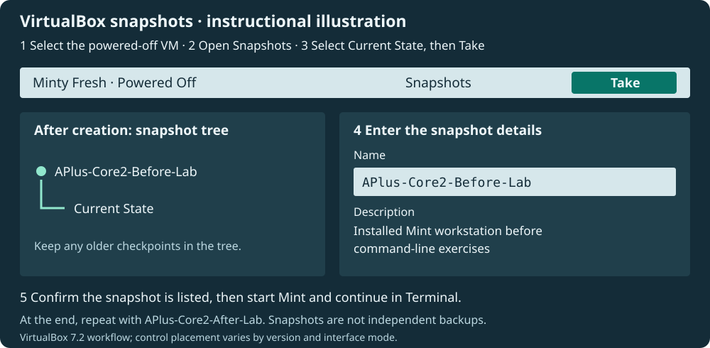
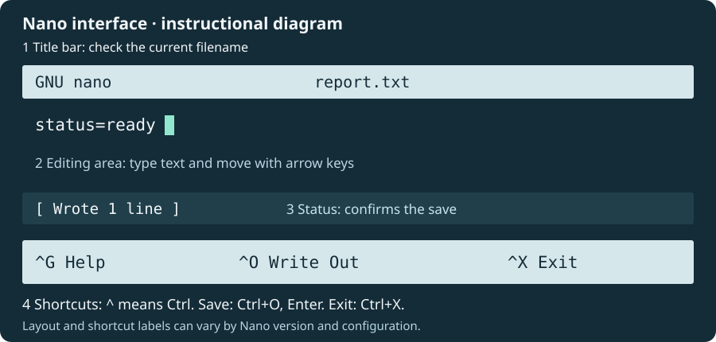

---
hub:
  kind: resource
template: article.html
---
# Linux Mint Workstation Setup and Troubleshooting

You are the support technician preparing the **Minty Fresh** workstation for regular use. Preserve its starting state, organize support files, investigate the system, and document what you find. Use your **real Linux Mint VM** throughout this assignment.

Your finished work is one report, `~/APlus-Linux-Lab/Reports/workstation-report.txt`, an archived copy, and two labeled VirtualBox snapshots. Each investigation adds to the same report.

## Before you begin

Complete [VirtualBox: Installing Linux Mint](../virtualbox-linux-mint/README.md) first. You need the installed VM, your regular Linux account and password, Terminal access, and free space on the Windows host for snapshots. Internet access is useful for package installation and external diagnostics; offline alternatives appear where needed.

Enter Linux commands **inside the guest's Terminal**, not Windows CMD or PowerShell. In Mint, press **Ctrl+Alt+T**, or open **Menu**, search for **Terminal**, and launch it. Click inside the VM before typing. The VirtualBox **Host key**, normally Right Ctrl on Windows, releases keyboard/mouse capture back to the host.

A prompt such as `student@minty-fresh:~$` identifies the account, computer, and current directory. Type only the command after the prompt, then press Enter. Do not type example output. Your username, paths, addresses, software versions, and results will differ from the illustrations.

Use the [Linux Command-Line Reference](../../../reference/linux-commands.md) for explanations and review. Use Linux's own manuals, command help, and Nano help to investigate options on the workstation. They complement each other: a local manual describes the installed tool; the Hub reference helps explain it.

Work through **task → help when needed → command → result → verification → report**. Early stages show commands; later stages ask you to choose and adapt tools you have already used. Run example lines separately. All exercise-file changes stay inside `~/APlus-Linux-Lab`; system configuration is inspected without editing it.

## 1. Preserve the starting workstation

Before changing files or installing utilities, confirm Mint boots from its installed virtual disk. A snapshot lets you return to a known VM state when testing changes, recovering from mistakes, or repeating an exercise.

1. Shut Mint down normally using **Menu → Quit → Shut Down**. In VirtualBox Manager, confirm **Powered Off**.
2. Select **Minty Fresh** in the machine list, then open **Snapshots**. In versions with a machine-tools selector, choose Snapshots there.
3. Select **Current State**, then **Take**. Enter `APlus-Core2-Before-Lab` and description `Installed Mint workstation before command-line exercises`.
4. Confirm the named snapshot appears with Current State beneath it. Keep any existing snapshots. Start the VM and sign in again.

[](images/snapshots.svg)

*Instructional illustration, not a screenshot. Labels follow the VirtualBox 7.2 snapshot workflow; interface placement can vary. Select the image to enlarge it.*

Snapshots use host storage and depend on VM files. They are not independent backups; preserve important files separately. Do not delete checkpoints casually. The [Oracle VirtualBox snapshot guide](https://docs.oracle.com/en/virtualization/virtualbox/7.2/user/working-with-vms.html) explains taking and restoring them.

**Verify:** The VM starts normally and `APlus-Core2-Before-Lab` remains listed in Manager.

## 2. Explore the terminal and find help

You need to know where a command will act before changing files. Open Terminal and run:

```bash
pwd
ls
cd /
pwd
ls
cd ~
pwd
```

`pwd` prints the current working directory. `ls` lists its contents. `cd /` visits the root of the directory tree; `cd ~` returns home, usually `/home/your-login`. An **absolute** path begins at `/`; a **relative** path begins in the current directory. `.` means here and `..` means the parent. Navigating does not move files. The root directory `/` is different from the root administrator account.

### Ask the installed system

```bash
man ls
```

Use arrows or Page Up/Page Down to scroll. Type `/hidden`, press Enter to search, and use `n` for the next match in the usual pager. Press `q` to return to the shell. Find the option that includes names beginning with a dot, then use it on your home directory. Dotfiles are normally hidden from a plain listing; they are not protected merely by being hidden.

<details><summary>Hint: turn the manual into a command</summary><p>Look for <code>-a, --all</code>. Use <code>ls -a</code> to include hidden entries, or <code>ls -la</code> for a long listing too. In <code>ls -a PATH</code>, <code>ls</code> is the command, <code>-a</code> is an option, and PATH is an argument naming the directory. Do not type the word PATH literally.</p></details>

Try the other help routes below, one at a time. Exit a manual before starting another command.

| Investigation | Command | What you learn |
| --- | --- | --- |
| Short usage summary | `ls --help` | Options without opening the manual pager. Not every program accepts `--help`. |
| Help for a Bash built-in | `help cd` | Bash documents commands implemented inside the shell. |
| Identify a command's kind | `type cd` | Usually reports that `cd` is a shell builtin. |
| Check whether a program is available | `command -v nano` | Prints its location if available; empty output can mean it is missing from the command search path. |
| Search manual descriptions | `man -k network` | Finds installed manual entries by keyword, rather than searching the internet. |
| Read a configuration format | `man 5 passwd` | Section 5 describes file formats; section 1's `passwd` describes a command. |

If a manual or keyword index is unavailable, use the tool's help, Bash `help` for built-ins, or the [reference's help guidance](../../../reference/linux-commands.md#man). Record that limitation later; a missing manual does not prove the program is absent. If Nano itself is unavailable, use Stage 11's APT procedure to install it, then return here.

### Check capitalization safely

First inspect whether this lab's workspace already exists:

```bash
ls -ld "$HOME/APlus-Linux-Lab"
```

**No such file or directory** is expected for a fresh run. If it exists, stop before the file exercises and inspect it. Preserve prior work. For a repeat, export anything important first, then use a known clean starting snapshot that predates the workspace. Do not delete an existing workspace to make these instructions fit.

Create a small sample area inside the lab workspace. `mkdir -p` creates missing directories; Stage 3 completes the workspace layout. `touch` creates an empty file if missing and otherwise updates its timestamps without clearing its contents.

```bash
mkdir -p "$HOME/APlus-Linux-Lab/Working/CaseDemo"
touch "$HOME/APlus-Linux-Lab/Working/CaseDemo/Report.txt"
touch "$HOME/APlus-Linux-Lab/Working/CaseDemo/report.txt"
touch "$HOME/APlus-Linux-Lab/Working/CaseDemo/REPORT.txt"
ls -1 "$HOME/APlus-Linux-Lab/Working/CaseDemo"
```

On Mint's usual home file system, these are **three different names**. Their displayed order can vary. Directory paths and command names normally distinguish capitalization too: `Reports` differs from `reports`, and `LS` is not the normal `ls` command. Use Tab completion to reduce mistakes.

**Verify:** You can return home, distinguish commands from output, exit a manual, and explain why all three filenames coexist. Keep one useful help option in mind for your report.

## 3. Organize the technician workspace

Keep working copies, reports, and archived material separate so the authoritative report is easy to identify. Complete the directory layout:

```bash
mkdir -p "$HOME/APlus-Linux-Lab/Working"
mkdir -p "$HOME/APlus-Linux-Lab/Reports"
mkdir -p "$HOME/APlus-Linux-Lab/Archive"
cd "$HOME/APlus-Linux-Lab"
pwd
ls
```

Expect `Archive`, `Reports`, and `Working`; `CaseDemo` is inside Working. `mkdir` creates directories. `-p` accepts an existing directory and creates missing parents; it does not erase contents. Success is usually silent, so verify with a listing.

Use a relative path to visit `Reports`, then return to the workspace:

```bash
cd Reports
pwd
cd ..
```

If a path is not found, use `pwd` and `ls` before trying again. Check the capital R. An absolute `cd "$HOME/APlus-Linux-Lab"` returns you to the workspace from elsewhere. `$HOME` expands to your home directory; quotes keep the complete path together.

**Verify:** Your current directory is the lab root and its three main directories exist. These same directories will be used through the final archive.

## 4. Begin the workstation report in Nano

Identify the account and system you are preparing:

```bash
whoami
hostname
cat /etc/os-release
```

`whoami` identifies the account running the command; `hostname` identifies the machine. In `os-release`, find the distribution's `PRETTY_NAME`. Keep your actual values rather than copying sample identities. `cat` displays a short text file without editing it.

Open the report:

```bash
nano "$HOME/APlus-Linux-Lab/Reports/workstation-report.txt"
```

Enter the following headings and fill the first four from your observations. This is text for the editor, **not shell commands**. Leave later sections ready for findings.

<pre><code>Linux Mint workstation report
Purpose: Prepare and investigate this workstation for regular use.
Account and workstation:
Distribution:
Workspace: APlus-Linux-Lab contains Working, Reports, and Archive.
File operations and case sensitivity:
Permissions and ownership:
Storage and processes:
Configuration files:
Kernel and startup components:
Networking:
Packages:
Problems and resolutions:
Help tools used:</code></pre>

1. Type normally; use arrows to move and Backspace/Delete to edit. Nano needs no separate insert mode.
2. Press **Ctrl+G** to open Nano's own help. Find how to leave help; in the common default layout, **Ctrl+X** returns to editing. Read the displayed shortcut labels if yours differ.
3. Press **Ctrl+O** (letter O) to **Write Out**, check the path in **File Name to Write**, then press **Enter**. Look for a written-line confirmation.
4. Press **Ctrl+X** to exit. Run the same Nano command to reopen the report, confirm your text, then exit again.

[](../../../assets/images/linux-reference/nano-interface.svg)

*Illustrative interface, not a Mint screenshot. `^` means hold Ctrl: `^G` is Ctrl+G. Shortcut labels can differ by version.*

Verify from the shell:

```bash
cat "$HOME/APlus-Linux-Lab/Reports/workstation-report.txt"
```

If saving fails, check whether Reports exists and whether the path has the right capitalization. Your own workspace should not need `sudo`. For more detail, use the [Nano reference](../../../reference/linux-commands.md#nano).

**Continue:** Reopen this same report after each investigation, add findings under its existing headings, save, and exit. Do not start separate reports for each stage.

## 5. Organize and verify support files

Keep the original in Reports. Investigate `cp --help` or `man cp`: which option asks before overwriting a destination? Find the corresponding option in `mv` help before changing a copy.

<details><summary>Hint: copy with confirmation</summary><p>The interactive option is <code>-i</code>. It asks before replacing an existing destination; answer <code>n</code> when you want to keep that file. With a new destination, success is normally silent.</p><pre id="linux-lab-copy"><code class="language-bash">cp -i "$HOME/APlus-Linux-Lab/Reports/workstation-report.txt" "$HOME/APlus-Linux-Lab/Working/working-copy.txt"</code></pre></details>

After copying, list Working and Reports. **Rename** the disposable copy, then **move** it into Archive:

```bash
mv -i "$HOME/APlus-Linux-Lab/Working/working-copy.txt" "$HOME/APlus-Linux-Lab/Working/checked-copy.txt"
mv -i "$HOME/APlus-Linux-Lab/Working/checked-copy.txt" "$HOME/APlus-Linux-Lab/Archive/checked-copy.txt"
```

`cp` leaves the original in place; `mv` changes a name or location. Confirm that Reports still has the original and Archive now has the copy. The archived working copy is a point-in-time copy; it will not automatically receive later report edits.

Find the report **by filename**, then find its purpose **inside its contents**:

```bash
find "$HOME/APlus-Linux-Lab" -type f -name "workstation-report.txt"
grep -n "Purpose:" "$HOME/APlus-Linux-Lab/Reports/workstation-report.txt"
```

`find` searches file entries under a starting path; `grep` searches matching text lines. Here `-type f` restricts the filename search to regular files, and `grep -n` adds line numbers. No grep output can mean the text or capitalization differs; first read the file with `cat`. `cat` reads; Nano edits.

Inspect the three case-demo files. Remove **only** the disposable all-uppercase one, confirming the exact name at the prompt:

```bash
ls -l "$HOME/APlus-Linux-Lab/Working/CaseDemo"
rm -i "$HOME/APlus-Linux-Lab/Working/CaseDemo/REPORT.txt"
ls -l "$HOME/APlus-Linux-Lab/Working/CaseDemo"
```

`rm` normally bypasses the graphical Trash. Do not add force or recursive flags. `Report.txt` and `report.txt` should remain. If the target is already absent, check your earlier steps instead of deleting a broader path.

**Update the report:** Record how you verified the copy, rename, move, filename search, content search, and precise removal. Use the [file-management reference](../../../reference/linux-commands.md#file-management) if the distinctions are unclear.

## 6. Check access permissions and ownership

Inspect `Archive/checked-copy.txt`, the disposable copy from Stage 5:

```bash
ls -l "$HOME/APlus-Linux-Lab/Archive/checked-copy.txt"
```

An **illustrative** listing could be:

<pre><code>-rw-r--r-- 1 student student 420 Oct 19 10:00 checked-copy.txt</code></pre>

The first character is the file type. The next nine form owner/group/others triplets. `r` reads, `w` writes, and `x` executes; `-` means that permission is absent. After the link count come the owning user and group. Your account and file size will differ. A directory needs `x` to traverse it; its `w` permission controls changing entries, so deleting a file depends on the parent directory too.

Use `man chmod` to discover a symbolic mode that gives the owner read/write and removes group/other access. Apply it **only to this copy**, then verify the listing.

<details><summary>Hint: set the intended permissions</summary><p><code>u</code> is owner, <code>g</code> group, <code>o</code> others; <code>=</code> sets the specified permissions exactly.</p><pre id="linux-lab-chmod"><code class="language-bash">chmod u=rw,go= "$HOME/APlus-Linux-Lab/Archive/checked-copy.txt"
ls -l "$HOME/APlus-Linux-Lab/Archive/checked-copy.txt"</code></pre><p>Expect <code>-rw-------</code>, apart from any extra access-control marker. Ownership stays the same.</p></details>

The numeric weights are read **4**, write **2**, execute **1**, added separately for each triplet. Use `chmod 640` on the same copy to grant owner read/write, group read, and others none. Verify `-rw-r-----`, then return it to `600` and verify `-rw-------`. A note does not need execute permission. The [permissions reference](../../../reference/linux-commands.md#reading-file-permissions) compares file and directory permissions.

`chown` changes ownership rather than permission bits. **For recognition only**, `sudo chown USER:GROUP FILE` would change a confirmed file to existing user/group identities. Changing the owning user normally requires root; do not run this placeholder or change system ownership. Your report's files should already belong to your account.

Try a read-only privilege comparison:

```bash
whoami
sudo whoami
whoami
```

Under normal Mint policy, `sudo` authenticates with your own password and authorizes one command as root; the middle result is normally `root`, and the last returns your regular identity. Password typing normally shows no characters. If denied, record it without changing policy. A permission error is a reason to check the target and account before seeking elevation.

By contrast, `su -` requests a root login shell and normally uses the target account's password. Mint commonly locks root password login. Read `man su` for recognition; do not enable root login or set a root password. An authorized switched shell lasts until `exit`.

**Update the report:** Identify owner/group, explain `600` and `640`, and distinguish `chmod`, `chown`, `sudo`, and `su`. Record the final mode you verified.

## 7. Investigate storage and running processes

Before judging a slow or nearly full workstation, distinguish file-system capacity from directory usage and a momentary process list from ongoing activity.

Use `df --help` to find human-readable units, then display capacity for the file system containing your home. Use `du --help` to find both human-readable units and a summary of the lab directory.

<details><summary>Hint: compare the two measurements</summary><pre id="linux-lab-storage"><code class="language-bash">df -h "$HOME"
du -sh "$HOME/APlus-Linux-Lab"</code></pre><p><code>df</code> shows Size, Used, Avail, Use%, and Mounted on for a file system. <code>du</code> measures allocated space used by a path's contents. The two totals describe different things. Guest free space also differs from free space on the Windows host storing the VM.</p></details>

Inspect a process snapshot, then watch a live view:

```bash
ps -ef
top
```

In `ps`, identify a PID, PPID (parent), owner, and command. In `top`, observe CPU and memory over several refreshes, then press **q** to exit. A brief CPU spike or low unused memory alone does not prove a fault; caches use RAM too. Record one process you recognize and what the figures actually show. Do not kill processes or change their priorities.

Check how storage joins the directory tree:

```bash
mount -t ext4
findmnt /
fsck --help
```

`mount -t ext4` lists existing ext4 mounts; it does not create one. `findmnt /` identifies the running root file system, its source, and mount options. A **mount point** is the directory where a file system appears. An unmounted file system can still exist on a device. If the ext4 listing is empty, inspect `findmnt /` rather than assuming the disk is missing.

`fsck --help` only displays usage. An actual `fsck` check examines supported file-system structures; a repair procedure needs protected data, the correct device/type, and an **unmounted** target, often using recovery/live media for the root file system. Do not run a check or repair on the mounted Mint system, alter active mounts, or assume all file-system types use the same repair tool.

**Update the report:** Record capacity/available space, lab directory usage, process observations, and the actual root mount. Explain why a space report is different from a consistency check.

## 8. Inspect system configuration without editing it

Use the local file-format manuals to interpret what you find. `man 5 passwd` describes account records; `man 1 passwd` describes the password-changing command. `man 5 fstab` describes mount records. Scroll, search, and quit as in Stage 2; use the [configuration reference](../../../reference/linux-commands.md#common-configuration-files) if a local manual is missing.

Run these **read-only** inspections. `$USER` normally contains your login name in Mint's terminal; compare it with `whoami` if the filtered account query is empty.

```bash
grep "^$USER:" /etc/passwd
ls -l /etc/shadow
cat /etc/hosts
cat /etc/fstab
ls -l /etc/resolv.conf
cat /etc/resolv.conf
```

| File under `/etc` | Technician's question | Fields to interpret |
| --- | --- | --- |
| `/etc/passwd` | Is the local account using the expected home and shell? | Colon-separated username, password placeholder, UID, primary GID, description, home, shell. `x` normally points to a separately stored hash. |
| `/etc/shadow` | Could password aging or a password lock explain authentication behavior? | Protected password/hash field and aging/security fields. Inspect its permissions and use the synthetic example below; do not display its contents. |
| `/etc/hosts` | Is a local mapping making this computer resolve a name differently? | Address, canonical hostname, optional aliases. Name-service order affects when applications consult it. |
| `/etc/fstab` | What mounts are configured persistently? | Source/UUID, mount point, type, options, dump flag, check pass. An entry describes intent, not proof that the volume is mounted now. |
| `/etc/resolv.conf` | Which resolver is configured? | `nameserver` gives a resolver address; `search` gives name suffixes. It may link to a dynamically managed file. |

For example, this **invented** hosts entry maps a documentation address to a name and alias:

<pre><code>192.0.2.25 printserver.example.test printserver</code></pre>

This **synthetic locked-account** shadow record contains no password hash:

<pre><code>demo:!:20000:0:99999:7:::</code></pre>

The nine fields are username, password/lock field, last change, minimum age, maximum age, warning, inactivity, expiration, and reserved. Dates use days since 1970-01-01; age values use days. `!` blocks password authentication, while other authentication methods may still be possible. Read `man 5 shadow` for field defaults. Do not use `sudo cat /etc/shadow`.

In resolver output, `nameserver 127.0.0.53` commonly indicates a local systemd-resolved stub, rather than an upstream server. NetworkManager or another service may manage the file, and manual edits may be overwritten. When applicable, `resolvectl status` is a read-only way to inspect upstream/per-interface DNS. Do not edit these five system files, modify accounts, or change persistent mounts or DNS settings.

**Update the report:** Give each file's purpose and one interpreted field. Use a description for shadow rather than copying sensitive contents. Note whether resolv.conf is a symbolic link and whether your resolver is local or remote.

## 9. Identify the startup components

Your report needs both the distribution and the kernel. They are related but have different version numbers. Reuse `cat /etc/os-release` for the distribution; inspect the running kernel and initialization system:

```bash
uname -r
ps -p 1 -o pid,comm
systemctl --version
systemctl status NetworkManager --no-pager
```

On a standard Mint installation, PID 1 is `systemd`. `systemctl --version` identifies the installed systemd tools; the process query checks what is actually PID 1. The service status may show **active (running)**, while **enabled** describes startup configuration. If a unit is absent or the query is denied, use `systemctl --help`/`man systemctl` and record the limit instead of changing services.

| Component | Place in startup and operation |
| --- | --- |
| Bootloader, commonly GRUB | Firmware starts the bootloader, which loads the kernel and usually initial RAM filesystem. A hidden GRUB menu does not prove GRUB is absent. |
| Linux kernel | Manages CPU, memory, processes, devices, and hardware access. |
| systemd | Takes over system initialization and manages services and other units. |
| Root account | UID 0 has broad administrative access. Services can run as root while password login for root remains locked. Root is an identity, not a startup stage. |

Inspect `ls /boot` and, if accessible, `ls /boot/grub` for boot-related files. Do not edit GRUB, reinstall a bootloader, unlock root, or stop/start services for this investigation. The [Linux system reference](../../../reference/linux-commands.md#linux-system-and-paths) explains the relationships.

**Update the report:** Add your actual kernel release, distribution, PID 1 result, service observation, and the startup sequence in your own words.

## 10. Diagnose workstation connectivity

Now choose tools based on the question. Mint's address belongs to the **guest**. With VirtualBox NAT it usually differs from the Windows host's LAN address; a private guest address is expected. Do not change the VM network mode to make sample values match.

| Tool | Question it helps answer | Native help to investigate |
| --- | --- | --- |
| `ip` | What interfaces, addresses, and routes exist? | `ip help` and `man ip` |
| `ping` | Are ICMP echo replies coming back? | `ping -h` or `man ping` |
| `curl` | Does a URL return an HTTP/HTTPS response? | `curl --help` or `man curl` |
| `dig` | What does DNS return for a name? | `dig -h` or `man dig` |
| `traceroute` | Which route hops respond? | `traceroute --help` or `man traceroute` |

First inspect interfaces/addresses and the default route:

```bash
ip -br address
ip route
ping -c 4 127.0.0.1
```

Find a non-loopback interface, its address/prefix, and the `default via` gateway. An **illustrative** NAT guest might show `enp0s3 UP 10.0.2.15/24` and `default via 10.0.2.2 dev enp0s3`. Use your values. Loopback replies confirm local TCP/IP response, not adapter, DNS, or internet success.

### Follow the evidence

1. Test the **actual gateway** from your route using four pings. Then test external IP reachability with `ping -c 4 -W 2 1.1.1.1`. `-c` bounds the count; `-W` bounds each reply wait in seconds.
2. Suppose an external IP responds and you now need to test **DNS independently of a website**. Choose a tool from the table, check that it exists with `command -v`, and query the IPv4 record for `example.com`.
3. Test an HTTPS response for `https://example.com`. Investigate the tool's header-only and total-time-limit options; keep the request bounded.
4. Investigate route hops to `example.com`, limiting the trace to eight hops and a short wait per probe.

<details><summary>Hint: bounded DNS, HTTPS, and path examples</summary><pre id="linux-lab-network"><code class="language-bash">command -v dig
dig +time=2 +tries=1 example.com A
curl -I --max-time 10 https://example.com
traceroute -n -m 8 -q 1 -w 1 example.com</code></pre><p><code>dig</code> shows DNS status, answer records, and the resolver under SERVER. <code>curl -I</code> requests HTTP headers; <code>--max-time</code> limits the operation. In the trace, <code>-n</code> avoids reverse lookups and <code>-q 1</code> sends one probe per hop. If a utility is missing, record the pending test and continue to Stage 11 before retrying it.</p></details>

Interpret the result before recommending a change:

| Observation | Useful next investigation |
| --- | --- |
| Only loopback, no usable guest address, or no default route | Recheck `ip` output and the VM's existing adapter/cable status. Compare with the [installation network check](../virtualbox-linux-mint/README.md#6-attach-the-iso-and-check-the-vm). Record missing settings; do not invent addresses. |
| Ping times out | Compare loopback, gateway, and another diagnostic. Filtering, ICMP restrictions, or a destination policy may explain it; timeout alone does not prove a host is offline. |
| DNS timeout versus NXDOMAIN | Timeout means no timely resolver reply; NXDOMAIN is a DNS answer that the name does not exist. `NOERROR` can still contain no records of the requested type. |
| Website responds but a trace has `*` hops | Routers may filter/deprioritize probes while forwarding traffic. Eight hops may not reach the destination. |
| HTTP 301/302, 403, or 405 | Redirect, denied access, and possibly unsupported HEAD are different from a DNS or TLS failure. Check the response rather than calling all of them “offline.” |
| `command not found` | Use `command -v TOOL`. Missing software/search-path problems differ from a tool that runs but gets a network failure. |

`dig` queries DNS directly; it does not use `/etc/hosts` the way many applications do. Keep TLS certificate verification enabled in curl. For protocol context, see [Ports & Protocols](../../../reference/ports-and-protocols.md).

**Update the report:** Record your interface/address/prefix, gateway, commands selected, actual outcomes, and what each result establishes. If offline, complete local inspection and loopback, label external tests pending, and continue without damaging the network configuration.

## 11. Install a missing diagnostic utility

Resolve a missing utility from the previous stage. Use **traceroute** as the worked example; if it already exists, inspect its package and preview installation instead of installing redundant software.

```bash
command -v traceroute
apt --help
apt search '^traceroute$'
apt show traceroute
apt list --installed traceroute
```

`command -v` checks command availability. APT queries describe packages from local repository metadata; `apt show` alone does not prove installation. Match the package's description to the task before installing it.

| Missing command | Mint package to inspect |
| --- | --- |
| `traceroute` | `traceroute` |
| `dig` | `dnsutils` (provides DNS tools through dependencies) |
| `curl` | `curl` |
| `nano` | `nano` |

If traceroute is missing and internet access is available, use the following sequence. **Only continue to installation if the metadata update succeeds.**

```bash
sudo apt update
sudo apt install traceroute
```

`update` downloads repository metadata; it does not upgrade installed applications. `install` adds the selected package and dependencies. Read the proposed package/disk changes before approving; do not add automatic confirmation. Enter your own password if asked. If you need a different missing tool, use the package mapping above and inspect that package first. Mint uses APT; do not add arbitrary repositories for this lab.

If already installed, `apt install --simulate traceroute` previews what would change without installing it. In either case, verify command availability/version, then repeat the pending path test:

```bash
command -v traceroute
traceroute --version
traceroute -n -m 8 -q 1 -w 1 example.com
```

If APT reports a repository/network error, check the network findings before retrying. If another package process holds a lock, let it finish; do not delete lock files. Without internet, use cached `apt show`/`apt list` information where available, read `man apt`, and document the proposed package and pending installation. Continue with available tools and complete the report; do not record an unperformed installation as successful.

For **recognition only**, Fedora/RHEL-family systems use DNF for similar work: `dnf info traceroute` queries metadata and `sudo dnf install traceroute` installs it there. Do not install or use DNF to manage Mint. The [package reference](../../../reference/linux-commands.md#package-management) compares the two.

**Update the report:** Record availability before/after, package/version information, any approved changes, and the repeated diagnostic's result. If offline, state exactly what remains pending.

## 12. Finalize and preserve the workstation report

Use the original Nano command from Stage 4. Complete the existing sections with your actual findings:

- Account/workstation, distribution, kernel, and directory layout.
- File operations, case sensitivity, owner/group, symbolic/numeric permissions, and privilege differences.
- File-system capacity, directory usage, process activity, and mount observations.
- The purpose and interpreted fields of all five configuration files.
- Interfaces/addressing, route, connectivity/DNS/HTTPS/path tests, and any limits.
- Package availability, installations or pending work, and diagnostic retests.
- Problems encountered, how you investigated them, and the result.
- Which help tools you used, one unfamiliar option you discovered, and how its documentation helped you choose it.

Keep passwords and shadow contents out of the report. Save with Ctrl+O, confirm with Enter, exit with Ctrl+X, then **reopen the same file** and verify the saved findings. Exit again before making the final archive:

```bash
cp -i "$HOME/APlus-Linux-Lab/Reports/workstation-report.txt" "$HOME/APlus-Linux-Lab/Archive/workstation-report-final.txt"
diff -s "$HOME/APlus-Linux-Lab/Reports/workstation-report.txt" "$HOME/APlus-Linux-Lab/Archive/workstation-report-final.txt"
ls -l "$HOME/APlus-Linux-Lab/Reports" "$HOME/APlus-Linux-Lab/Archive"
```

`diff -s` is a supporting read-only comparison: it reports identical files when the saved report and archive match. If they differ, inspect both paths and the file contents before deciding which copy is current. Do not overwrite an archive you intend to keep. `checked-copy.txt` remains the earlier disposable copy, not the final deliverable.

**Verify:** Reports contains the complete workstation report; Archive contains its matching final copy. Export important work to a separate host folder or independent backup if you need it outside the VM. Two copies inside the same VM are both affected by restoring an earlier snapshot.

## 13. Preserve the completed VM

Save and close your work, then shut Mint down normally. In VirtualBox Manager, select the VM, open **Snapshots**, select **Current State**, and choose **Take**.

Name the snapshot `APlus-Core2-After-Lab`. Use description `Completed workstation report, archived copy, and diagnostic findings`. Confirm both Before-Lab and After-Lab appear; leave the completed state in place.

### Repeat the lab later

Restoring **Before-Lab** reverts the VM's snapshotted disks and settings, including later file/package changes. The report may disappear from the current VM. Before restoring, preserve anything needed outside the VM and keep the After-Lab checkpoint. With the VM powered off, select Before-Lab and choose **Restore**; review any offer to snapshot the current state before confirming. You can later restore After-Lab to return to that checkpoint. Host/shared-folder files are outside the guest disk snapshot and need separate care.

**Do not restore now.** Finish with your completed environment preserved. Snapshots consume host space and are not independent backups.

[Linux Command-Line Reference](../../../reference/linux-commands.md) · [Installation walkthrough](../virtualbox-linux-mint/README.md) · [A+ Core 2](../../../certifications/comptia/a-plus-core-2/README.md) · [Back to IT Support Labs](../README.md) · [Student Hub](../../../../README.md)
