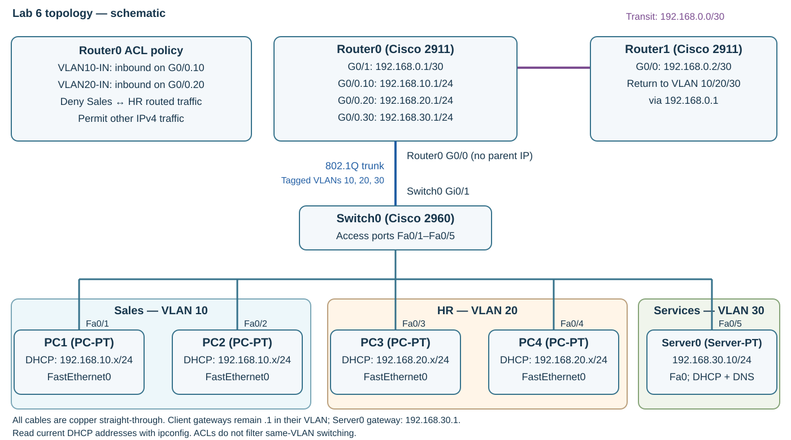

---
hub:
  kind: resource
template: article.html
---
# Lab 6 — ACL Traffic Control

Use named extended IPv4 access control lists on Router0 to block routed traffic between Sales and HR while preserving each department's access to shared services. Add Router1's route to Services before enforcing the policy.

## Learning objectives

- Establish a working baseline before changing access policy.
- Interpret extended ACL entries, wildcard masks, ordering, and interface direction.
- Apply and verify a policy that blocks selected traffic while preserving DHCP, DNS, and permitted connectivity.

## Before you begin

Complete [Lab 5 — Centralized DHCP and DNS Services](../centralized-dhcp-dns/README.md). Open **Lab5_Centralized_DHCP_DNS.pkt**. Server0 must already supply DHCP and DNS, with Router0 relaying DHCP from Sales and HR. Use the release in the [Packet Tracer setup guide](../packet-tracer-setup/README.md).

| Quantity | Device | Starting state |
| --- | --- | --- |
| 2 | Cisco 2911 Router0 and Router1 | Keep all interfaces and existing routes |
| 1 | Cisco 2960 Switch0 | Keep all three VLANs, access ports, and trunk |
| 4 | PC1–PC4 | DHCP clients in their original Sales/HR VLANs |
| 1 | Server-PT Server0 | Static 192.168.30.10, DHCP and DNS enabled |
| 0 | Additional devices or cables | Reuse Lab 5's complete topology |

## 1. Preserve the network and verify the baseline

1. Select **File → Save As** and create **Lab6_ACL_Traffic_Control.pkt**. Keep the completed Lab 5 file.
2. Run `ipconfig` on **all four PCs** and record their actual leased addresses, masks, and gateways. Confirm DNS **192.168.30.10** in **Desktop → IP Configuration** if the basic command output omits it.
3. From **PC1**, run the commands below, then enter `ping` followed by **PC3's actual address**. From **PC3**, ping **PC1's actual address** as a reverse check.
4. Verify Router0's interfaces and routing table before changing ACLs.

### PC1 — baseline

```console
ipconfig
ping 192.168.30.10
nslookup server.lab.local
```

### Router0 — baseline

At `Router#`, run:

```console
show ip interface brief
show ip route
show running-config
```

**Checkpoint:** Both inter-VLAN pings and the Server0 ping work, and the lookup returns **192.168.30.10**. Router0 has working .10/.20/.30 subinterfaces, the transit interface, and connected routes for those networks. Fix any baseline failure first. A pre-existing failure is not evidence that a later ACL works.

### Addressing and policy reference

| Network / role | Subnet mask | Gateway / important addresses | Required policy |
| --- | --- | --- | --- |
| 192.168.10.0/24 — Sales VLAN 10 | 255.255.255.0 | Router0 G0/0.10: 192.168.10.1; PC1/PC2 use DHCP | Block routed traffic to HR; allow same-VLAN peers and shared services |
| 192.168.20.0/24 — HR VLAN 20 | 255.255.255.0 | Router0 G0/0.20: 192.168.20.1; PC3/PC4 use DHCP | Block routed traffic to Sales; allow same-VLAN peers and shared services |
| 192.168.30.0/24 — Services VLAN 30 | 255.255.255.0 | Router0 G0/0.30: 192.168.30.1; Server0: 192.168.30.10 | Both departments and Router1 can reach Server0 |
| 192.168.0.0/30 — transit | 255.255.255.252 | Router0 G0/1: 192.168.0.1; Router1 G0/0: 192.168.0.2 | Keep Router1 reachable from both departments |

| Existing connection | Port assignment |
| --- | --- |
| PC1/PC2 FastEthernet0 → Switch0 | Fa0/1–2, respectively; access VLAN 10 |
| PC3/PC4 FastEthernet0 → Switch0 | Fa0/3–4, respectively; access VLAN 20 |
| Server0 FastEthernet0 → Switch0 | Fa0/5; access VLAN 30 |
| Switch0 → Router0 | Gi0/1 → G0/0; trunk allows 10,20,30 |
| Router0 → Router1 | G0/1 → G0/0; /30 transit |

All existing cables remain copper straight-through. Router0's physical G0/0 stays enabled and unaddressed; ACLs will attach to two **subinterfaces**, not Switch0 or the parent interface.

[](images/topology.svg)

*ACL topology schematic, not a Packet Tracer screenshot. The physical network is unchanged; select the image to enlarge the policy and interface labels.*

## 2. Add Router1's Services route

Router1 already has the two static routes from Lab 3. VLAN 30 was added later. Router0 knows Services as a directly connected network, but Router1 needs an explicit route through **192.168.0.1**.

Open **Router1 → CLI**, starting at `Router>`; skip `enable` if already at `Router#`. Use `end` first if still in a configuration mode. Confirm the device window: Router0 and Router1 can both have the default IOS hostname `Router`.

```console
enable
configure terminal
ip route 192.168.30.0 255.255.255.0 192.168.0.1
end
copy running-config startup-config
```

Press **Enter** at **Destination filename [startup-config]?**. At **Router1's `Router#`**, verify:

```console
show ip route
ping 192.168.30.10
```

**Checkpoint:** Router1 has a static **192.168.30.0/24** route via **192.168.0.1**, alongside its existing Sales/HR routes, and Server0 replies. Repeat once for initial ARP; fix a persistent failure before applying ACLs. Server0's **192.168.30.1** default gateway provides its return path to the transit network.

## 3. Configure and apply Router0's ACLs

A **standard IPv4 ACL** matches source addresses. An **extended IPv4 ACL** can also match destinations and protocols, and TCP/UDP ports when specified. This policy needs source and destination subnet matches, so use extended ACLs. Names help identify their intended placement. Each individual rule is an **access control entry (ACE)**.

Open **Router0 → CLI**. Start at `Router>`; skip `enable` if already at `Router#`.

```console
enable
configure terminal
ip access-list extended VLAN10-IN
deny ip 192.168.10.0 0.0.0.255 192.168.20.0 0.0.0.255
permit ip any any
exit
ip access-list extended VLAN20-IN
deny ip 192.168.20.0 0.0.0.255 192.168.10.0 0.0.0.255
permit ip any any
exit
interface GigabitEthernet0/0.10
ip access-group VLAN10-IN in
exit
interface GigabitEthernet0/0.20
ip access-group VLAN20-IN in
end
copy running-config startup-config
```

Accept the startup-config filename with **Enter**.

### Read the policy

| Command part | Meaning |
| --- | --- |
| `ip access-list extended VLAN10-IN` | Define the named extended IPv4 ACL for traffic arriving from Sales. |
| `deny ip` | Deny all matching IPv4 traffic, including ICMP, TCP, and UDP; this is broader than blocking only ping. |
| `192.168.10.0 0.0.0.255` | Source expression: match the Sales /24. |
| `192.168.20.0 0.0.0.255` | Destination expression: match the HR /24. |
| `permit ip any any` | Permit remaining IPv4 traffic after the specific deny. |
| `ip access-group VLAN10-IN in` | Check packets as they enter Router0 through G0/0.10 from Sales. |

**VLAN20-IN** reverses the source and destination expressions and is inbound on **G0/0.20**. Inbound/outbound directions are relative to the router interface: inbound arrives at Router0; outbound leaves it. An ACL definition must be attached to an interface to enforce this policy there.

In a **wildcard mask**, a **0 bit must match** and a **1 bit is ignored**. Thus **192.168.10.0 0.0.0.255** matches **192.168.10.0 through 192.168.10.255**, including both endpoints. The ordinary usable host range of that /24 is **.1 through .254**; that is different from the ACL's matching range.

ACLs evaluate entries **top to bottom**, taking the **first matching** action. An invisible **implicit deny** follows the last entry. Put the specific deny before `permit ip any any`: moving the broad permit first would allow the cross-VLAN traffic, while omitting it would also block required services. The broad permit is intentional for this introductory policy; production least-privilege designs may need more restrictive permits.

Same-VLAN traffic is switched locally, so PC1↔PC2 and PC3↔PC4 do not encounter these Router0 ACLs. Traffic to **Server0 in 192.168.30.0/24** or **Router1 in 192.168.0.0/30** does not match either cross-VLAN deny. Initial DHCP requests from **0.0.0.0** to **255.255.255.255** also reach the broad permit, preserving relay. Service replies enter through the Services or transit interface; no inbound ACL is added there and no outbound ACL is added to the client subinterfaces.

## 4. Verify policy and service continuity

1. On **all four PCs**, open **Desktop → IP Configuration**, select **Static**, then **DHCP**. Confirm a fresh successful request with the correct VLAN subnet, /24 mask, gateway, and DNS **192.168.30.10**. This exercises relay after the ACL change.
2. Run **`ipconfig`** on each PC again and update your address notes before the tests below. Lease order can change.
3. For a PC target, enter `ping` followed by that target's **actual current IPv4 address**. For the fixed targets and lookups, use the commands in the table.
4. Record every result. Repeat an isolated initial timeout after ARP resolves; investigate persistent unexpected results.

| Test source → target | Command / target | Expected | Reason |
| --- | --- | --- | --- |
| PC1 → PC2 | Ping PC2's actual leased address | Success | Same Sales VLAN; locally switched |
| PC3 → PC4 | Ping PC4's actual leased address | Success | Same HR VLAN; locally switched |
| PC1 → PC3 | Ping PC3's actual leased address | Blocked | Sales-to-HR traffic matches VLAN10-IN's deny |
| PC3 → PC1 | Ping PC1's actual leased address | Blocked | HR-to-Sales traffic matches VLAN20-IN's deny |
| PC1 → Server0 | `ping 192.168.30.10` | Success | Sales retains Services access |
| PC3 → Server0 | `ping 192.168.30.10` | Success | HR retains Services access |
| PC1 DNS lookup | `nslookup server.lab.local` | Success; 192.168.30.10 | DNS remains reachable and resolves the A record |
| PC3 DNS lookup | `nslookup server.lab.local` | Success; 192.168.30.10 | HR also retains DNS access |
| PC1 → Router1 | `ping 192.168.0.2` | Success | Sales retains transit access and Router1 has its return route |
| PC3 → Router1 | `ping 192.168.0.2` | Success | HR retains transit access and Router1 has its return route |
| Router1 → Server0 | `ping 192.168.30.10` | Success | New Services route and Server0 return gateway work |

The two blocked pings are expected policy results **only when the baseline and the permitted paths have been independently verified**. Failed pings alone cannot distinguish filtering from bad addressing, cabling, or routing.

### Inspect Router0's configuration

At its privileged `Router#` prompt:

```console
show access-lists
show running-config
show ip interface GigabitEthernet0/0.10
show ip interface GigabitEthernet0/0.20
```

**Checkpoint:** Both ACLs show the specific deny before the permit. The .10 interface has inbound **VLAN10-IN**, and .20 has inbound **VLAN20-IN**. Where the simulated IOS supplies match counters, compare them before and after the cross-VLAN tests.

Packet Tracer implements a subset of IOS; detailed output can vary. If a detailed `show ip interface` command is unavailable or omits ACL fields, inspect the **full `show running-config`** for the correct `ip access-group ... in` line under each subinterface and both named ACL definitions. Use the traffic tests to verify enforcement. **`show ip interface brief` alone does not verify ACL attachment.**

### Troubleshooting

| Symptom | Check |
| --- | --- |
| Sales still reaches HR | Verify VLAN10-IN's exact source/destination expressions, deny-before-permit order, and inbound attachment on G0/0.10. |
| HR still reaches Sales | Verify VLAN20-IN and its inbound attachment on G0/0.20. One ACL does not replace the reverse-direction policy. |
| Both departments lose Server0 or Router1 access | Check each ACL's `permit ip any any`, its order, and whether an ACL was mistakenly attached elsewhere. Recheck routes and Server0's gateway. |
| DHCP fails after applying ACLs | Check the broad permits and correct interface attachments; preserve both helpers, DHCP service, and Server0's pools. Verify one renewed client in each VLAN before assuming relay works. |
| Same-VLAN pings fail | Check current PC addresses, masks, access VLANs, and cabling. These packets should not traverse Router0's inbound ACLs. |
| Server0 IP ping works but DNS fails | Check the renewed DNS option, Server0 DNS On, and exact A record. |
| Router1 cannot reach Server0 | Verify the new static route, transit reachability, Services trunk/subinterface, and Server0's 192.168.30.1 gateway. |

## 5. Save and finish

1. If corrections changed either router, save its configuration again with `copy running-config startup-config` at `Router#`, then press **Enter** at the filename prompt.
2. Keep both ACLs **applied** and select **File → Save**. Confirm **Lab6_ACL_Traffic_Control.pkt** contains the completed policy and Server0 services.

### Completion checklist

- Router1 retains its Sales/HR routes and has the Services route through 192.168.0.1.
- Router1 can ping Server0 at 192.168.30.10.
- Both named extended ACLs have the correct deny first and broad permit second.
- VLAN10-IN is inbound on G0/0.10; VLAN20-IN is inbound on G0/0.20.
- PC1↔PC3 is blocked in both directions; same-VLAN pings succeed in Sales and HR.
- Both departments can renew DHCP, use DNS, and reach Server0 and Router1.
- Router configurations and **Lab6_ACL_Traffic_Control.pkt** are saved with the ACLs active.

## Optional rollback — troubleshooting or reset only

**Skip this section after successful completion.** Use it only to reset an attempt or temporarily remove filtering during troubleshooting. Keep the completed saved project with its ACLs active; use a separate copy for a reset.

At **Router0**, starting at `Router>` (skip `enable` at `Router#`):

```console
enable
configure terminal
interface GigabitEthernet0/0.10
no ip access-group VLAN10-IN in
exit
interface GigabitEthernet0/0.20
no ip access-group VLAN20-IN in
exit
no ip access-list extended VLAN10-IN
no ip access-list extended VLAN20-IN
end
```

The `no ip access-group` commands **detach** filtering from the interfaces. The `no ip access-list extended` commands **delete** the definitions. These are separate actions; an unattached definition does not enforce the policy. To finish the lab after a reset, reapply Section 3, repeat the verification matrix, and save the completed policy again.

[Previous: Lab 5 — Centralized DHCP and DNS Services](../centralized-dhcp-dns/README.md) · [Back to Networking Labs](../README.md) · [Network+](../../../certifications/comptia/network-plus/README.md)
