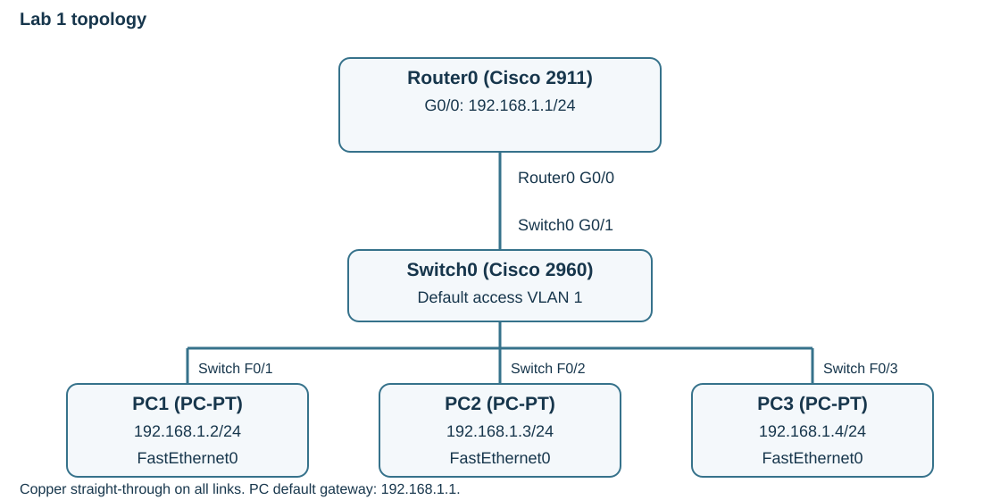

---
hub:
  kind: resource
template: article.html
---
# Lab 1 — Basic Network Configuration

Build a small local area network (LAN), assign IPv4 addresses, and verify communication between three PCs and a router. A LAN connects devices within a local area; here, all devices are simulated inside Packet Tracer.

## Learning objectives

- Place and cable the assigned devices using the correct interfaces.
- Configure unique host addresses, a subnet mask, and a default gateway.
- Enable a router interface, test connectivity, and save both kinds of configuration.

## Before you begin

Complete [Getting Started: Download and Install Cisco Packet Tracer](../packet-tracer-setup/README.md). You need Packet Tracer installed and authenticated, the **Logical** workspace, and **Realtime** mode. Start with a new blank project; no physical networking equipment is needed.

| Quantity | Device or material | Where to find it |
| --- | --- | --- |
| 1 | Cisco 2911 router, **Router0** | Network Devices → Routers → 2911 |
| 1 | Cisco 2960 switch, **Switch0** | Network Devices → Switches → 2960 |
| 3 | PC-PT clients, **PC1**, **PC2**, **PC3** | End Devices → PC |
| 4 | Copper straight-through cables | Connections, the lightning-bolt category |

The switch connects the PCs within the LAN. Router0 provides the LAN's gateway, which a host uses when sending traffic to another network. The PCs provide endpoints for configuration and testing.

## 1. Build the topology

1. Open a new blank Packet Tracer workspace.
2. Place the 2911 router and 2960 switch. Keep their workspace names **Router0** and **Switch0**.
3. Place three PCs. Packet Tracer starts numbering at **PC0**. Open each PC's **Config** tab and change **Display Name** so the devices are named **PC1**, **PC2**, and **PC3**.
4. Select **Connections → Copper Straight-Through** and connect the exact interfaces below. A device's port menu appears after you select it with the cable tool.

| First endpoint | Second endpoint |
| --- | --- |
| PC1 FastEthernet0 | Switch0 FastEthernet0/1 |
| PC2 FastEthernet0 | Switch0 FastEthernet0/2 |
| PC3 FastEthernet0 | Switch0 FastEthernet0/3 |
| Switch0 GigabitEthernet0/1 | Router0 GigabitEthernet0/0 |

[](images/topology.svg)

*Topology schematic. Interface abbreviations G and F mean GigabitEthernet and FastEthernet. Select the image to enlarge it.*

**Checkpoint:** There is one router, one switch, three correctly named PCs, and four cables. PC-to-switch links may take time to turn green as the switch initializes. The router link can remain down until you enable Router0's interface in Step 3.

## 2. Address the PCs

For each PC, open **Desktop → IP Configuration**, select **Static**, and enter its values. The router row is configured in the next step.

| Device / interface | IPv4 address | Subnet mask | Default gateway |
| --- | --- | --- | --- |
| Router0 GigabitEthernet0/0 | 192.168.1.1 | 255.255.255.0 | Not configured for this lab |
| PC1 FastEthernet0 | 192.168.1.2 | 255.255.255.0 | 192.168.1.1 |
| PC2 FastEthernet0 | 192.168.1.3 | 255.255.255.0 | 192.168.1.1 |
| PC3 FastEthernet0 | 192.168.1.4 | 255.255.255.0 | 192.168.1.1 |

The mask **255.255.255.0**, also written **/24**, places these addresses in **192.168.1.0/24**. Each device needs a unique address; duplicate addresses can cause intermittent or failed communication. The PCs use the same mask so they agree about which destinations are local. The subnet's network address, `192.168.1.0`, and broadcast address, `192.168.1.255`, are not host assignments.

The **default gateway** is the router interface on the PC's own subnet, here `192.168.1.1`. PC-to-PC traffic within this subnet is switched locally rather than forwarded through the gateway. Leave DNS unconfigured; these tests use IP addresses and do not require name resolution.

**Checkpoint:** Reopen each PC's IP Configuration and compare all three fields with the table. Router0 will not answer pings until Step 3 is complete.

## 3. Configure Router0

1. Open **Router0 → CLI** and press **Enter** if needed.
2. If asked **Would you like to enter the initial configuration dialog?**, type `no`, press **Enter**, then press **Enter** again if prompted to begin.
3. At the `Router>` prompt, enter the following commands one line at a time. The code block contains commands only; do not type prompt symbols or explanatory text.

```console
enable
configure terminal
interface GigabitEthernet0/0
ip address 192.168.1.1 255.255.255.0
no shutdown
exit
exit
copy running-config startup-config
```

When **Destination filename [startup-config]?** appears, press **Enter** to accept it. Wait for the command to finish before entering another command.

| Command / prompt | What it means |
| --- | --- |
| `enable` → `Router#` | Enter privileged EXEC mode for configuration and diagnostic commands. |
| `configure terminal` → `Router(config)#` | Enter global configuration mode. |
| `interface GigabitEthernet0/0` → `Router(config-if)#` | Select the interface connected to Switch0. |
| `ip address …` | Assign the gateway address and mask to that interface. |
| `no shutdown` | Remove the interface's administrative shutdown. Router Ethernet interfaces can be disabled until explicitly enabled. |
| First `exit`, then second `exit` | Leave interface mode, then global configuration mode, returning to `Router#`. |
| `copy running-config startup-config` | Save the active device configuration as its startup configuration. |

**Router0** is the workspace display name. The IOS prompt may still say **Router**; changing a display name does not necessarily change the IOS hostname. Use the workspace name to confirm that you opened the intended device.

At `Router#`, run:

```console
show ip interface brief
```

**Checkpoint:** **GigabitEthernet0/0** shows **192.168.1.1**, **Status up**, and **Protocol up** once the link initializes. Other unused interfaces may remain administratively down; do not enable them for this lab.

### Why Switch0 needs no configuration yet

The fresh switch's access ports share the default VLAN 1, so these PCs occupy the same Layer 2 network. Switch0 learns each frame's **source MAC address** and the port where it arrived. It uses that MAC address table to forward known unicast frames toward the destination port; broadcasts and unknown unicasts are flooded to other ports in that VLAN. The switch does not need an IP address to perform this Layer 2 forwarding. VLAN configuration begins in Lab 2.

## 4. Verify connectivity

1. On **PC1 → Desktop → Command Prompt**, run the commands in the PC1 block below.
2. On **PC2** and **PC3**, open their simulated Command Prompts and run the second block on each PC.
3. Compare each PC's configuration with the addressing table. Repeat a ping if the first attempt times out, then use the troubleshooting table if failures continue.

**PC1:**

```console
ipconfig
ping 192.168.1.1
ping 192.168.1.3
ping 192.168.1.4
```

**PC2 and PC3, separately:**

```console
ipconfig
ping 192.168.1.1
```

| Test | Expected result |
| --- | --- |
| Each PC pings 192.168.1.1 | Router0 replies through its LAN interface. |
| PC1 pings 192.168.1.3 | PC2 replies through Switch0. |
| PC1 pings 192.168.1.4 | PC3 replies through Switch0. |

An initial ping may time out while **Address Resolution Protocol (ARP)** learns the next hop's MAC address or a link finishes initializing. For a local PC destination, the next hop is that PC. For an off-subnet destination, the PC resolves its gateway's MAC address instead. Repeated failures are a reason to investigate, rather than keep retrying indefinitely.

### Troubleshooting

| Symptom | Check |
| --- | --- |
| A link stays red | Verify the device models, copper straight-through cable, and both endpoint interfaces against the connection table. On Router0, check `show ip interface brief`. |
| Router0 shows administratively down | Enter `configure terminal`, select `interface GigabitEthernet0/0`, enter `no shutdown`, then `end`. Recheck from `Router#`. |
| PCs cannot reach the router | Check Router0's address and mask, its up/up status, and each PC's address, mask, and gateway. |
| PC-to-PC pings fail | Check unique addresses, matching /24 masks, and the PC switch ports. No additional switch configuration should be necessary in this fresh topology. |
| A diagnostic command is rejected | Router `show` commands belong at the privileged `Router#` prompt. Use `end` to leave configuration mode first. PC commands belong in the simulated PC Command Prompt. |
| Only the first ping fails | Allow link initialization and ARP resolution, then repeat the test and inspect the final result. |

**Checkpoint:** The gateway responds from every PC, and PC1 can reach both other PCs.

## 5. Save and finish

1. If you corrected Router0's configuration during troubleshooting, run `copy running-config startup-config` again at `Router#` and accept the destination filename with **Enter**.
2. Select **File → Save As** and save **Lab1_Basic_Network.pkt** in your lab folder.
3. Keep this completed file. Lab 2 starts from it.

Saving the **.pkt project** preserves the simulated topology and its state. Saving **running-config to startup-config** preserves a router's settings for its simulated startup. Perform both; saving the project does not replace learning the device's configuration-save procedure.

### Completion checklist

- Router0 is a 2911, Switch0 is a 2960, and PC1–PC3 are connected through the specified interfaces.
- Every device has the address and mask listed in the plan; every PC has gateway 192.168.1.1.
- Router0 GigabitEthernet0/0 is up/up at 192.168.1.1/24.
- All required gateway and PC-to-PC ping tests succeed.
- Router0's startup configuration and **Lab1_Basic_Network.pkt** are saved.

[Next: Lab 2 — VLAN Configuration](../vlan-configuration/README.md)

[Previous: Packet Tracer setup](../packet-tracer-setup/README.md) · [Back to Networking Labs](../README.md) · [Network+](../../../certifications/comptia/network-plus/README.md)
