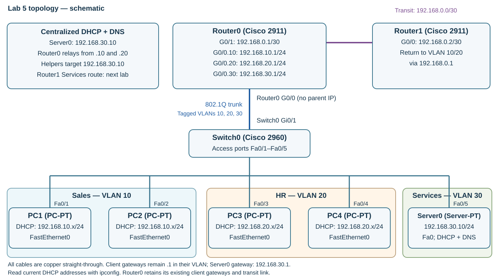

---
hub:
  kind: resource
template: article.html
---
# Lab 5 — Centralized DHCP and DNS Services

Move DHCP to Server0 in a new Services VLAN. Keep Router0 as each VLAN's gateway, use it to relay client requests, and add internal DNS records on the server.

## Learning objectives

- Extend the existing access/trunk network with Services VLAN 30.
- Distinguish a DHCP server from a DHCP relay agent.
- Configure Server0's static address, DHCP pools, and DNS A records.
- Verify renewed client options, IP connectivity, and name resolution separately.

## Before you begin

Complete [Lab 4 — DHCP Configuration](../dhcp-configuration/README.md). Open **Lab4_DHCP_Configuration.pkt** and verify all four clients obtain leases and PC1 can ping PC3. Use the release in the [Packet Tracer setup guide](../packet-tracer-setup/README.md).

| Quantity | Device or material | Starting state |
| --- | --- | --- |
| 2 | Cisco 2911 Router0 and Router1 | Keep gateways, transit addressing, and Router1's Sales/HR routes |
| 1 | Cisco 2960 Switch0 | Keep all client ports and the Gi0/1 trunk |
| 4 | PC1–PC4 | Keep in their original VLANs and renew DHCP later |
| 1 | New Server-PT, displayed as Server0 | Add from **End Devices → Server** |
| 1 | New copper straight-through cable | Server0 FastEthernet0 → Switch0 FastEthernet0/5 |

## 1. Add Server0 and preserve existing connections

1. Select **File → Save As** and create **Lab5_Centralized_DHCP_DNS.pkt**. Keep the completed Lab 4 file.
2. Add **Server0** and connect its **FastEthernet0** to **Switch0 FastEthernet0/5** using **Copper Straight-Through**.
3. Keep the original trunk, clients, and router transit connection exactly as shown below.

| Connection | Switch0 port | VLAN role |
| --- | --- | --- |
| PC1 FastEthernet0 | Fa0/1 | Sales access VLAN 10 |
| PC2 FastEthernet0 | Fa0/2 | Sales access VLAN 10 |
| PC3 FastEthernet0 | Fa0/3 | HR access VLAN 20 |
| PC4 FastEthernet0 | Fa0/4 | HR access VLAN 20 |
| Server0 FastEthernet0 | Fa0/5 | New Services access VLAN 30 |
| Router0 GigabitEthernet0/0 | **Gi0/1** | Existing trunk; extend to carry VLANs 10, 20, 30 |

**Fa0/1 remains PC1's access port.** The router trunk is **Gi0/1**. Router0 **G0/1** still connects to Router1 **G0/0** over the existing copper straight-through transit link.

[](images/topology.svg)

*Centralized-services schematic, not a Packet Tracer screenshot. Select the image to inspect the ports and gateway addresses.*

### Addressing plan

| VLAN / purpose | Network | Subnet mask | Gateway / Router0 subinterface | Host assignment |
| --- | --- | --- | --- | --- |
| 10 — Sales | 192.168.10.0/24 | 255.255.255.0 | 192.168.10.1 on G0/0.10 | PC1/PC2; DHCP starts at 192.168.10.11 |
| 20 — HR | 192.168.20.0/24 | 255.255.255.0 | 192.168.20.1 on G0/0.20 | PC3/PC4; DHCP starts at 192.168.20.11 |
| 30 — Services | 192.168.30.0/24 | 255.255.255.0 | 192.168.30.1 on G0/0.30 | Server0 static 192.168.30.10 |
| Router transit | 192.168.0.0/30 | 255.255.255.252 | Router0 G0/1: 192.168.0.1; Router1 G0/0: 192.168.0.2 | Unchanged |

## 2. Configure Services VLAN 30 on Switch0

Open **Switch0 → CLI**, starting at `Switch>`; skip `enable` if already at `Switch#`. Use `end` first if still in a configuration mode.

```console
enable
configure terminal
vlan 30
name Services
exit
interface FastEthernet0/5
switchport mode access
switchport access vlan 30
no shutdown
exit
interface GigabitEthernet0/1
switchport mode trunk
switchport trunk allowed vlan 10,20,30
end
copy running-config startup-config
```

Press **Enter** at **Destination filename [startup-config]?**.

The explicit allowed list carries all three VLANs across the existing trunk. This command **replaces** the allowed list: entering only `30` would remove Sales and HR from it. Fa0/5 is an access port because Server0 sends ordinary untagged Ethernet traffic in VLAN 30.

At `Switch#`, verify:

```console
show vlan brief
show interfaces trunk
```

**Checkpoint:** VLAN 30 is named **Services** and includes Fa0/5. Fa0/1–2 remain in VLAN 10 and Fa0/3–4 in VLAN 20. Gi0/1 is trunking and allows **10,20,30**. The trunk is checked separately from the access-port listing.

## 3. Move Router0 from DHCP server to relay

In Lab 4, Router0 owned the pools and assigned leases. Here, Server0 will own the pools. Router0 forwards client requests across the VLAN boundary to **192.168.30.10**.

Open **Router0 → CLI**. From `Router>`, enter the following; skip `enable` at `Router#`. Router0 is a workspace name, so confirm the device window even if its IOS prompt says only `Router`.

```console
enable
configure terminal
service dhcp
no ip dhcp pool VLAN10
no ip dhcp pool VLAN20
interface GigabitEthernet0/0.30
encapsulation dot1Q 30
ip address 192.168.30.1 255.255.255.0
no shutdown
exit
interface GigabitEthernet0/0.10
ip helper-address 192.168.30.10
exit
interface GigabitEthernet0/0.20
ip helper-address 192.168.30.10
end
show ip dhcp binding
copy running-config startup-config
```

Accept the startup-config filename with **Enter**. Keep G0/0 enabled and unaddressed, and preserve the existing .10/.20 gateway addresses.

**`service dhcp` enables both the IOS DHCP server and relay functions** and is normally enabled by default. Remove the old pools to stop local allocations; using `no service dhcp` would also disable the relay needed here.

DHCP starts with a broadcast that routers do not ordinarily forward between VLANs. Each `ip helper-address` receives requests on its **client-facing subinterface** and forwards them toward Server0 as unicast. The relay identifies the originating subnet so the server can select the appropriate pool. Server0 needs a working default gateway to return traffic to other subnets.

Leave the old excluded-address statements on Router0. They constrain only **Router0's local DHCP server**, not Server0's allocations. Server0's starting addresses and pool sizes below control its ranges. Historical Router0 bindings may remain; an immediately empty binding table is not a requirement. The important transition checks are removal of the old pools and correct options after clients renew.

## 4. Give Server0 a static address

Open **Server0 → Desktop → IP Configuration**, select **Static**, and enter:

| Setting | Value |
| --- | --- |
| IP Address | 192.168.30.10 |
| Subnet Mask | 255.255.255.0 |
| Default Gateway | 192.168.30.1 |
| DNS Server | 192.168.30.10 |

Infrastructure services commonly use predictable addresses: the relay and clients must consistently find this server. Its DNS setting points to itself because it will provide the internal DNS service.

**Checkpoint:** On **Server0 → Desktop → Command Prompt**, run:

```console
ping 192.168.30.1
```

Expect replies. Fix Server0's address, Fa0/5 VLAN, trunk allowance, or Router0's .30 subinterface before proceeding if this fails persistently.

## 5. Create Server0's DHCP pools

The controls below follow Cisco's [Server configuration Help](https://tutorials.ptnetacad.net/help/default/config_servers.htm). Its example images do not establish the installed patch release.

1. Open **Server0 → Services → DHCP**.
2. In **Interface**, choose **FastEthernet0**. Set **Service** to **On**.
3. If an unused **serverPool** appears, select it in the lower list and choose **Remove** when available. Some versions protect the default entry; if removal is disabled, leave it untouched and create the two named pools below. This lab needs no VLAN 30 client pool.
4. Enter the **VLAN10** column and click **Add**. Repeat with **VLAN20** and click **Add** again.
5. Select each new pool in the list and verify its saved fields. **Save** updates a selected existing pool; use **Add** to create one.

| Field | VLAN10 pool | VLAN20 pool |
| --- | --- | --- |
| Pool Name | VLAN10 | VLAN20 |
| Default Gateway | 192.168.10.1 | 192.168.20.1 |
| DNS Server | 192.168.30.10 | 192.168.30.10 |
| Start IP Address | 192.168.10.11 | 192.168.20.11 |
| Subnet Mask | 255.255.255.0 | 255.255.255.0 |
| Maximum Number of Users | 200 | 200 |
| TFTP Server | 0.0.0.0 | 0.0.0.0 |
| WLC Address | 0.0.0.0 | 0.0.0.0 |

**Start IP Address** is the first allocation; **Maximum Number of Users** limits the number of addresses. Starting at **.11** with **200** addresses gives **.11 through .210**, inclusive, in each /24. This leaves .1–.10 outside these pools without relying on Router0's exclusions. The mask identifies the client subnet; the gateway is that subnet's Router0 subinterface. Both pools direct DNS queries to **Server0 at 192.168.30.10**. TFTP and wireless-controller services are unused.

## 6. Enable internal DNS

1. Open **Server0 → Services → DNS** and set the DNS service to **On**.
2. Enter each **Name** and **Address** below, choose type **A**, and click **Add** for each record.
3. Verify all three records appear in the list.

| Name | Type | Address |
| --- | --- | --- |
| server.lab.local | A | 192.168.30.10 |
| dns.lab.local | A | 192.168.30.10 |
| router.lab.local | A | 192.168.30.1 |

An **A record** maps a name to an IPv4 address. The first two names deliberately point to the same server; the third points to Router0's Services gateway. The **lab.local** names are specific to this simulation, not a recommended production DNS namespace.

## 7. Renew all four client leases

1. On **PC1 → Desktop → IP Configuration**, select **Static**, then **DHCP** to restart the request.
2. Repeat on **PC2, PC3, and PC4**, allowing each request to finish.
3. Run `ipconfig` in each PC's **Desktop → Command Prompt** and record the current addresses. Inspect **DNS Server** in **Desktop → IP Configuration** if the basic command output omits DNS.

**Expected:** PC1/PC2 use **192.168.10.0/24**, gateway **192.168.10.1**; PC3/PC4 use **192.168.20.0/24**, gateway **192.168.20.1**. Every PC has mask **255.255.255.0** and DNS server **192.168.30.10**. Exact lease order may vary. An old **8.8.8.8** DNS setting indicates a stale lease or an old Router0 pool still serving clients.

## 8. Verify DHCP, DNS, and routing

### PC1

Open **Desktop → Command Prompt**:

```console
ipconfig
ping 192.168.30.10
nslookup server.lab.local
nslookup dns.lab.local
ping server.lab.local
```

Then enter `ping` followed by **PC3's current DHCP-assigned IPv4 address**, as reported by PC3's `ipconfig`.

**Expected:** The address ping succeeds, both lookups return **192.168.30.10**, the named ping succeeds, and PC1 can still reach PC3. Repeat an initial ping if ARP has not completed; persistent timeouts need investigation.

### PC3

```console
nslookup router.lab.local
ping 192.168.30.1
ping router.lab.local
```

**Expected:** The name resolves to **192.168.30.1**, and the Services gateway replies to both the address and named pings. Together, the PC1 and PC3 lookups check all three A records.

### Router0

At its privileged `Router#` prompt:

```console
show ip interface brief
show ip route connected
show running-config
show ip dhcp binding
```

If `show ip route connected` is unavailable in the simulated IOS, use **`show ip route`** and inspect the connected entries.

**Checkpoint:** G0/0.10, .20, and .30 are up/up with their .1 gateways. Connected routes include all three /24s and the /30 transit subnet. The full configuration has **`ip helper-address 192.168.30.10` under both .10 and .20**, and no local `ip dhcp pool VLAN10` or `VLAN20` definition. Server0 now assigns leases; retained old router bindings alone do not disprove the transition. Verify the renewed DNS option and Server0's saved pools as well.

**Keep Router1's two existing Sales/HR routes unchanged.** Router1's route to Services is added in Lab 6. Do not use Router1-to-Server0 reachability as a completion requirement yet.

### Troubleshooting

| Symptom | Check |
| --- | --- |
| No lease, 0.0.0.0, or 169.254.x.x | Confirm Server0 DHCP is On on FastEthernet0, both named pools exist, and the appropriate client subinterface has the helper address. Check the VLAN/trunk path and Server0 gateway. |
| Only one VLAN gets DHCP | Compare that VLAN's helper and corresponding Server0 pool, gateway, start address, and mask. |
| Renewed PC still uses 8.8.8.8 | Inspect Router0's full configuration for a remaining local pool. Confirm Server0's DNS field and renew the PC again. |
| Server0 cannot ping 192.168.30.1 | Check static address/mask, cable to Fa0/5, VLAN 30 membership, trunk allowed list, and .30 subinterface. |
| Server0 reaches its gateway but cannot reply to clients | Confirm its static default gateway is 192.168.30.1 and Router0's client interfaces/routes are intact. |
| Server0 IP ping works but name lookup fails | Check the PC's DNS option, Server0 DNS service On, and exact A-record name/address. An IP ping tests connectivity without testing DNS. |
| Gateway pings work but a remote subnet fails | Inspect Router0's connected routes and the destination's gateway. DHCP success alone does not prove end-to-end routing. |

## 9. Save and finish

1. Save any corrected router/switch configuration with `copy running-config startup-config` at the appropriate privileged prompt, accepting the filename with **Enter**.
2. Select **File → Save** and confirm **Lab5_Centralized_DHCP_DNS.pkt**. The project save retains Server0's services and the PC settings for Lab 6.

### Completion checklist

- Server0 FastEthernet0 connects to Switch0 Fa0/5 in Services VLAN 30.
- Gi0/1 still trunks to Router0 G0/0 and allows VLANs 10,20,30; original client access ports are unchanged.
- Router0 has the 192.168.30.1/24 subinterface and helpers on .10 and .20.
- The two old Router0 pools are removed; DHCP relay service remains enabled.
- Server0 uses the static address, gateway, and DNS settings and has both correct 200-address pools.
- DNS is On with all three A records.
- All four PCs renew successfully with correct VLAN settings and DNS 192.168.30.10.
- PC1's IP/name tests and inter-VLAN ping succeed; PC3 resolves and reaches the Services gateway.
- Device configurations and **Lab5_Centralized_DHCP_DNS.pkt** are saved.

[Previous: Lab 4 — DHCP Configuration](../dhcp-configuration/README.md) · [Next: Lab 6 — ACL Traffic Control](../acl-traffic-control/README.md) · [Back to Networking Labs](../README.md) · [Network+](../../../certifications/comptia/network-plus/README.md)
