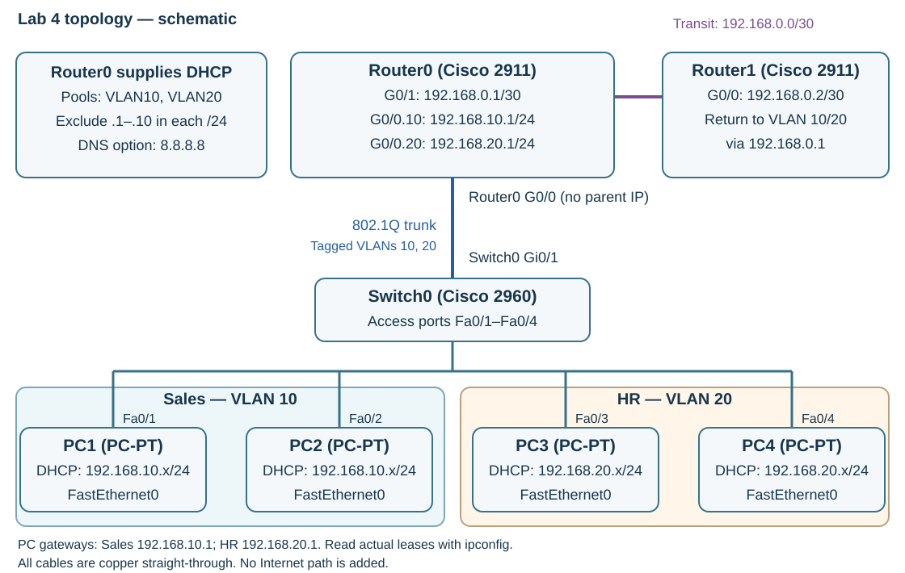

---
hub:
  kind: resource
template: article.html
---
# Lab 4 — DHCP Configuration

Continue the routed network from Lab 3. Configure Router0 to assign IPv4 settings automatically to Sales and HR, then verify the leases and inter-VLAN connectivity.

## Learning objectives

- Configure DHCP exclusions and a pool for each client VLAN.
- Identify the address, subnet mask, gateway, and DNS option delivered to a client.
- Verify leases and distinguish an address-assignment problem from a connectivity problem.

## Before you begin

Complete [Lab 3 — Static Routing](../static-routing/README.md). Open **Lab3_Static_Routing.pkt** and confirm PC1 and PC3 can still ping Router1 at **192.168.0.2**. Use the release in the [Packet Tracer setup guide](../packet-tracer-setup/README.md).

| Quantity | Device | Starting state |
| --- | --- | --- |
| 2 | Cisco 2911 Router0 and Router1 | Keep the VLAN gateways, /30 transit link, and Router1's two static routes |
| 1 | Cisco 2960 Switch0 | Keep the Sales/HR access ports and Gi0/1 trunk |
| 4 | PC1–PC4 | Change only their IPv4 configuration method in this lab |
| 0 | Additional devices or cables | Reuse the entire Lab 3 topology |

## 1. Preserve the starting network

1. Select **File → Save As** and create **Lab4_DHCP_Configuration.pkt**. Keep the completed Lab 3 file.
2. Confirm the connections below. Do not recable the network or change its VLANs, router addresses, or routes.

| Link | Endpoints | Cable |
| --- | --- | --- |
| Sales clients | PC1/PC2 FastEthernet0 → Switch0 Fa0/1 and Fa0/2, respectively | Existing copper straight-through |
| HR clients | PC3/PC4 FastEthernet0 → Switch0 Fa0/3 and Fa0/4, respectively | Existing copper straight-through |
| VLAN trunk | Switch0 Gi0/1 → Router0 G0/0 | Existing copper straight-through |
| Router transit | Router0 G0/1 → Router1 G0/0 | Existing copper straight-through |

[](images/topology.svg)

*DHCP topology schematic, not a Packet Tracer screenshot. Client addresses are dynamic; select the image to enlarge it.*

### Addressing and DHCP options

| Clients | VLAN / network | Subnet mask | Default gateway | DNS server | Earliest available DHCP address |
| --- | --- | --- | --- | --- | --- |
| PC1, PC2 | 10 — Sales, 192.168.10.0/24 | 255.255.255.0 | 192.168.10.1 | 8.8.8.8 | 192.168.10.11 |
| PC3, PC4 | 20 — HR, 192.168.20.0/24 | 255.255.255.0 | 192.168.20.1 | 8.8.8.8 | 192.168.20.11 |

| Router interface | Static IPv4 address | Subnet mask |
| --- | --- | --- |
| Router0 G0/0.10 | 192.168.10.1 | 255.255.255.0 |
| Router0 G0/0.20 | 192.168.20.1 | 255.255.255.0 |
| Router0 G0/1 | 192.168.0.1 | 255.255.255.252 |
| Router1 G0/0 | 192.168.0.2 | 255.255.255.252 |

Router0's physical **G0/0** stays enabled and unaddressed. Its subinterfaces remain static because clients need predictable default gateways. Router1's routes to **192.168.10.0/24** and **192.168.20.0/24** still use **192.168.0.1**.

### What DHCP changes

DHCP automates client IPv4 configuration. A **pool**, also called a scope, describes the subnet and options the server offers. A **lease** is a time-limited assignment of an address to a client. **Exclusions** keep selected addresses out of this router's allocation process.

For a new lease, remember **DORA**: the client broadcasts **Discover**, a server sends an **Offer**, the client sends a **Request**, and the server sends an **Acknowledge**. Renewals can reuse an existing lease without repeating the entire initial exchange.

| Labs 1–3: static client settings | Lab 4: DHCP client settings |
| --- | --- |
| Enter the address, mask, and gateway on each PC. | Receive the address, mask, gateway, and DNS option from Router0. |
| Track every host address manually. | Manage pools centrally and inspect leases. |
| Update each PC when settings change. | Deliver updated options when clients obtain or renew leases. |

Central management reduces repetitive work and addressing mistakes. Keep manually configured infrastructure addresses outside client allocations.

## 2. Configure DHCP on Router0

Open **Router0 → CLI**. Start at `Router>`; skip `enable` if already at `Router#`. Use `end` first if still in a configuration mode. Router0 is the workspace name; the IOS prompt may simply say `Router`.

```console
enable
configure terminal
ip dhcp excluded-address 192.168.10.1 192.168.10.10
ip dhcp excluded-address 192.168.20.1 192.168.20.10
ip dhcp pool VLAN10
network 192.168.10.0 255.255.255.0
default-router 192.168.10.1
dns-server 8.8.8.8
exit
ip dhcp pool VLAN20
network 192.168.20.0 255.255.255.0
default-router 192.168.20.1
dns-server 8.8.8.8
end
copy running-config startup-config
```

Press **Enter** at **Destination filename [startup-config]?**. Do not type that prompt as a command.

The exclusions reserve **.1 through .10** in each subnet from Router0's DHCP allocation, including the gateway. Each `network` statement selects a /24; `default-router` and `dns-server` provide client options. **8.8.8.8 is only an option distributed in this exercise.** This isolated topology does not provide a path to the Internet or establish working external DNS resolution.

Router0 receives the client broadcasts on its directly connected VLAN subinterfaces and selects the corresponding local pool. No **`ip helper-address`** is needed while Router0 itself serves these VLANs.

**Checkpoint:** At `Router#`, run `show running-config`. Find both excluded ranges and both complete pools, including their network, gateway, and DNS settings.

## 3. Change the PCs to DHCP

1. Open **PC1 → Desktop → IP Configuration**.
2. Select **DHCP** and allow the request to finish.
3. Repeat on **PC2, PC3, and PC4**.
4. On each PC, open **Desktop → Command Prompt** and run:

```console
ipconfig
```

**Expected:** Each PC receives the correct subnet, /24 mask, gateway, and **8.8.8.8** DNS option from the table. Check the **DNS Server** field in **Desktop → IP Configuration** if the basic `ipconfig` output omits it. Allocation starts at **.11** in each subnet; the exact client-to-address order can vary. Record each PC's actual address before testing connectivity.

## 4. Verify leases and routed connectivity

At **Router0's `Router#`** prompt, run:

```console
show ip dhcp binding
show ip interface brief
show running-config
```

**Expected:** Client bindings correspond to the PCs' assigned addresses. G0/0.10 and G0/0.20 retain **192.168.10.1** and **192.168.20.1** and are up/up; the transit interface remains **192.168.0.1/30**. The complete running configuration contains both pools and exclusions.

The source's optional shortcut is:

```console
show running-config | include dhcp
```

If the simulated IOS rejects the filter, use **`show running-config`** and scroll. Even when accepted, the filter only locates lines containing `dhcp`; pool settings such as `network` and `default-router` need the unfiltered view.

On **PC3**, run `ipconfig` again. From **PC1**, enter `ping` followed by **PC3's actual assigned IPv4 address**. For example, **only if PC3 reports 192.168.20.11**, use:

```console
ping 192.168.20.11
```

**Expected:** Replies across the VLANs. Repeat once if the first attempt loses a packet while ARP resolves; investigate persistent failure. A lease proves that address assignment worked, but does not by itself prove the gateway or routed path works.

### Troubleshooting

| Symptom | Check |
| --- | --- |
| No address, 0.0.0.0, or a self-assigned 169.254.x.x address | Check the matching pool, PC access-port VLAN, trunk, and Router0 subinterface status. Restart the request by selecting **Static**, then **DHCP** in IP Configuration. |
| Address from the wrong subnet | Check Switch0 Fa0/1–2 are in VLAN 10 and Fa0/3–4 are in VLAN 20 using `show vlan brief`. Compare both pool `network` statements. |
| No Router0 bindings after a request | Confirm the CLI window is Router0, inspect the full DHCP configuration, and retry DHCP. DHCP service is enabled by default; if the configuration contains `no service dhcp`, reenable it with `service dhcp` in global configuration mode. |
| Correct lease, but gateway ping fails | Check the assigned gateway and mask, access-port VLAN, Gi0/1 trunk with `show interfaces trunk`, and corresponding Router0 subinterface. |
| Gateway works, but PC1 cannot ping PC3 | Use PC3's current address. Recheck both clients and router-on-a-stick configuration; do not change the transit route to fix a local inter-VLAN fault. |
| External name lookup fails | This lab distributes 8.8.8.8 without Internet connectivity. Internal DNS is introduced in Lab 5. |

## 5. Save and finish

1. If troubleshooting changed Router0, save again with `copy running-config startup-config` at `Router#` and accept the filename with **Enter**.
2. Select **File → Save** and confirm the project is **Lab4_DHCP_Configuration.pkt**. Retain it as Lab 5's starting file.

### Completion checklist

- Router0 excludes .1–.10 in both VLAN subnets.
- VLAN10 and VLAN20 pools have the correct /24 network, gateway, and DNS option.
- All four PCs use DHCP and receive addresses from the correct subnets.
- Router0 displays client bindings, and its original interfaces and routes remain intact.
- PC1 can ping PC3's actual leased address.
- Router0's startup configuration and **Lab4_DHCP_Configuration.pkt** are saved.

[Previous: Lab 3 — Static Routing](../static-routing/README.md) · [Next: Lab 5 — Centralized DHCP and DNS Services](../centralized-dhcp-dns/README.md) · [Back to Networking Labs](../README.md) · [Network+](../../../certifications/comptia/network-plus/README.md)
