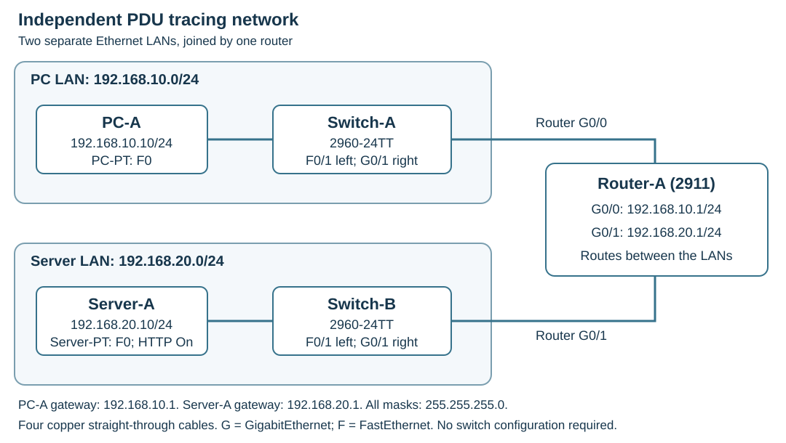

# OSI & TCP/IP Models — PDU Encapsulation and Decapsulation

Follow simulated traffic from a PC, through two switches and a router, to a web server. Inspect the protocol data units (PDUs) to see which information each device uses, adds, or removes.

| Lab information | Details |
| --- | --- |
| Certification | CompTIA Network+ (N10-009) |
| Estimated time | 60–75 minutes, including setup and observations |
| Starting point | A new, blank Packet Tracer project; this is an independent lab |
| Software | Cisco Packet Tracer 9.0.1 installed and signed in locally |
| Prior knowledge | Basic IPv4 addresses, subnet masks, and default gateways |
| Deliverables | Your saved `.pkt` project, observation worksheet, and review responses |

If you need the software, use [Download and Install Cisco Packet Tracer](../packet-tracer-setup/README.md). Completion of Labs 1–6 is not required. All devices in this activity are simulated; no physical equipment is needed.

## Learning objectives

- Relate all seven OSI layers to the four-layer TCP/IP model.
- Distinguish application data, TCP segments, IP packets, Ethernet frames, and transmitted bits.
- Trace encapsulation, switching, routing, and receiving-side decapsulation.
- Compare local-link MAC addressing with end-to-end IPv4 addressing.
- Recognize ARP, ICMP, TCP, and HTTP in an actual simulation trace.

This activity primarily supports **N10-009 objective 1.1** (OSI functions), with supporting practice for **1.2** (switches, routers, and TTL), **1.4** (protocols, ports, and traffic types), and **1.7** (IPv4 addressing). See the [Network+ Objective Breakdown](../../../certifications/comptia/network-plus/objective-breakdown.md#11-osi-reference-model) for supporting explanations.

## Setup: build a small routed network

### 1. Place and connect the devices

1. Start a new blank project in the **Logical** workspace and **Realtime** mode.
2. Place the following devices. Open each device's **Config** tab and set its **Display Name** to match the table. Do not substitute a router with different interface numbering.
3. Select **Connections → Copper Straight-Through** and connect the four links in the cabling table. Choose interfaces from each device's port menu.

| Quantity | Packet Tracer device | Display name | Device category |
| --- | --- | --- | --- |
| 1 | PC-PT | PC-A | End Devices → PC |
| 2 | 2960 (2960-24TT) switches | Switch-A, Switch-B | Network Devices → Switches |
| 1 | 2911 router | Router-A | Network Devices → Routers |
| 1 | Server-PT | Server-A | End Devices → Server |

| First endpoint | Second endpoint |
| --- | --- |
| PC-A FastEthernet0 | Switch-A FastEthernet0/1 |
| Switch-A GigabitEthernet0/1 | Router-A GigabitEthernet0/0 |
| Router-A GigabitEthernet0/1 | Switch-B GigabitEthernet0/1 |
| Switch-B FastEthernet0/1 | Server-A FastEthernet0 |

[](images/topology.svg)

*Topology schematic. G means GigabitEthernet; F means FastEthernet. Select the image to enlarge it. This is a diagram, not a Packet Tracer screenshot.*

The switches need no configuration or management IP addresses. Leave their default access-port settings. The router separates the two LANs even though both switches use their default VLAN. There is no trunk between them.

### 2. Address the endpoints

Open **Desktop → IP Configuration** on PC-A and Server-A, select **Static**, and enter their values. Leave DNS unconfigured; you will access the web server by IPv4 address.

| Device / interface | IPv4 address | Subnet mask | Default gateway |
| --- | --- | --- | --- |
| PC-A FastEthernet0 | 192.168.10.10 | 255.255.255.0 (/24) | 192.168.10.1 |
| Router-A GigabitEthernet0/0 | 192.168.10.1 | 255.255.255.0 (/24) | Not needed |
| Router-A GigabitEthernet0/1 | 192.168.20.1 | 255.255.255.0 (/24) | Not needed |
| Server-A FastEthernet0 | 192.168.20.10 | 255.255.255.0 (/24) | 192.168.20.1 |

Each endpoint's gateway is on its own subnet. Configure the router rows in the next step.

### 3. Enable the router interfaces

Open **Router-A → CLI**. Press **Enter** if needed. If the initial configuration dialog appears, answer `no`, then press **Enter** to reach `Router>`. Enter these commands one line at a time; do not type IOS prompt symbols.

```console
enable
configure terminal
hostname Router-A
interface GigabitEthernet0/0
ip address 192.168.10.1 255.255.255.0
no shutdown
exit
interface GigabitEthernet0/1
ip address 192.168.20.1 255.255.255.0
no shutdown
end
copy running-config startup-config
```

Press **Enter** at **Destination filename [startup-config]?** and wait for the save to finish. `configure terminal` selects global configuration mode; `interface` selects interface configuration mode; `end` returns to privileged EXEC mode. `no shutdown` enables each interface. The hostname command also makes the IOS prompt identify Router-A.

At `Router-A#`, check:

```console
show ip interface brief
show ip route
```

**Expected:** G0/0 and G0/1 show their assigned addresses and **up/up** after link initialization. The routing table contains connected routes for **192.168.10.0/24** through G0/0 and **192.168.20.0/24** through G0/1. An unused G0/2 can remain administratively down. Both networks are directly connected, so no static route, dynamic routing protocol, or router default route is required.

### 4. Enable HTTP and save the starting project

1. Open **Server-A → Services → HTTP** and set **HTTP** to **On**. Keep the supplied `index.html`; no page editing is necessary.
2. Wait in **Realtime** until all four links are ready. Switch ports can briefly appear amber while they initialize.
3. Use **File → Save As** and save your own project as `OSI_PDU_Tracing.pkt`.
4. Do not ping or browse yet. Capture the first traffic in Part 2 so that you can observe address resolution.

This lab provides complete build instructions rather than a downloadable starter `.pkt`. Save periodically as you work; saving the Packet Tracer project and saving the router's startup configuration are separate actions.

## Part 1: understand Simulation Mode

1. Select **Simulation** at the lower right. **Realtime** lets protocols run continuously; Simulation lets you pause and inspect event-driven processing.
2. Locate the **Simulation Panel** and its **Event List**. The list identifies the current device, previous device, protocol type, and simulation time. Enlarge the panel or scroll horizontally if a column is hidden.
3. Open **Edit Filters**. Clear the selected protocols with **Show All/None**, then enable only **ARP** and **ICMP**. Close the filter window. Hidden protocols still operate; filtering controls what you see.
4. Locate **Capture/Forward** and **Auto Capture/Play**. Use Capture/Forward to advance by one simulation step. Auto Capture/Play runs automatically; select it again to pause. Several events can occur during one step.
5. After generating traffic in Part 2, select the colored event square in the **Info/Type** area, or the envelope on the topology, to open **PDU Information at Device**. Check the device name and protocol so you inspect the intended event.

| PDU Information view | How to use it |
| --- | --- |
| **OSI Model** | Select an active layer and read the processing explanation below it. Read **In Layers** from Layer 1 upward and **Out Layers** from the upper active layer downward. |
| **Inbound PDU Details** | Inspect headers received at this device. A locally originated PDU has no inbound view. |
| **Outbound PDU Details** | Inspect headers being sent. An event with no outgoing PDU has no outbound view. |

Some events only transmit a buffered frame; others show more of the stack. A single communication can generate ARP exchanges, an ICMP request and reply, or TCP setup and HTTP messages. Do not expect one row per device or an identical set of tabs at every event.

**Reset Simulation** clears the visible event history and restarts the scenario; it does not clear ARP tables or delete user-created PDU processes. Record your observations before resetting or returning to Realtime.

## Part 2: trace an ICMP exchange

### 1. Generate the traffic

1. In Simulation Mode, select **Add Simple PDU**, the closed-envelope tool.
2. Select **PC-A** as the source, then **Server-A** as the destination. This queues a one-shot ping, an ICMP echo request.
3. Select **Capture/Forward** repeatedly. Open the ARP and ICMP events as they appear. Close each PDU window before advancing.
4. If the first attempt fails while ARP entries are being learned, finish that exchange, then create another Simple PDU from PC-A to Server-A. A first-attempt timeout alone does not prove the configuration is wrong.

**If no ARP appears:** a previous exchange may already have populated the caches. Finish the current traffic and remove its test entries in the **User Created PDU List** using the delete control for those entries. Return to Realtime, confirm the router configuration was saved with `copy running-config startup-config`, and save the project. Use **Power Cycle Devices** to restart the devices and clear their temporary tables. Wait for links to recover, check both router interfaces are up/up, then return to Simulation, enable ARP/ICMP filters, and create a fresh Simple PDU. Recheck endpoint addressing and HTTP after the restart. Reset Simulation alone will not produce a fresh ARP exchange.

### 2. Inspect address resolution

Follow an ARP request and its reply on each LAN when resolution is needed. Examine the **Ethernet II** and **ARP** sections in PDU Details. Record the target IPv4 address being resolved and the MAC address learned.

- PC-A recognizes that Server-A is on another subnet. It needs the MAC address of **192.168.10.1**, its local gateway, rather than Server-A's remote MAC address.
- Router-A needs Server-A's MAC address on its directly connected **192.168.20.0/24** LAN. It performs a separate resolution there when that entry is missing.
- The switch forwards an ARP broadcast within its LAN. Router-A does not forward that broadcast into the other LAN. ARP replies normally return as unicast frames.

ARP carries its own message directly inside an Ethernet frame; it is **not inside an IPv4 packet**. The IPv4 addresses shown in an ARP message are fields used for address resolution, not an enclosing IP header.

### 3. Follow the request and reply

1. Find an **ICMP echo request** at PC-A. In **Outbound PDU Details**, record the Ethernet source/destination MAC addresses and IPv4 source/destination addresses. Inspect the ICMP section. This traffic contains no TCP or UDP header and has no TCP/UDP ports.
2. Follow that request through **Switch-A**. Inspect its OSI processing. It learns source MAC addresses and uses the destination MAC to forward the frame; an unknown unicast can be flooded to other eligible ports until learned. It does not select an IP route or replace the frame's endpoint MAC addresses.
3. At **Router-A**, inspect the arriving request and the forwarded request. Compare Inbound and Outbound PDU Details where both are available. If resolution or buffering creates separate events, use the matching request's receive and send events. Match IPv4 addresses and the ICMP identifier/sequence fields where shown.
4. Follow the request through **Switch-B** to **Server-A**. Inspect the server's inbound OSI processing and the ICMP echo request.
5. Continue until Server-A's **echo reply** returns through Switch-B, Router-A, and Switch-A to PC-A. The server creates a new reply with the endpoint IPv4 addresses reversed. Do not confuse its headers with the original request.

**Checkpoint:** After resolution, the request reaches Server-A and a reply reaches PC-A. The User Created PDU List reports a successful completed test. Use that round trip as the reachability check; no earlier ping is required.

If repeated attempts fail, check the four cables, both endpoint masks and gateways, and Router-A's up/up interfaces and connected routes in Realtime. Verify both gateways: from PC-A use `ping 192.168.10.1`; from Server-A use `ping 192.168.20.1`. Then retry `ping 192.168.20.10` from PC-A. These diagnostic pings populate caches; use the fresh-capture procedure above if you still need ARP observations.

## Part 3: observe encapsulation and decapsulation

Return to the recorded request events and compare the actual header sections. **Encapsulation** adds protocol control information around a higher-layer PDU; **decapsulation** processes and removes that information as the receiver passes the contents upward.

| Traffic | Outgoing encapsulation in this lab |
| --- | --- |
| HTTP over TCP, in Part 4 | HTTP data → TCP segment → IPv4 packet → Ethernet frame → transmitted bits |
| ICMP echo | ICMP message → IPv4 packet → Ethernet frame → transmitted bits |
| ARP | ARP message → Ethernet frame → transmitted bits |

**Data → segment → packet → frame → bits** is a useful TCP example, not a mandatory sequence for every protocol. TCP uses **segments**; UDP uses **datagrams**, but this activity does not generate UDP traffic. Ethernet adds a header and trailer. Layer 1 represents the frame's bits as physical signals; the animation is not a measurement of individual electrical signals.

Use the request's OSI view to explain each transition:

1. **PC-A:** IP supplies addressing for delivery toward Server-A; Ethernet supplies addressing for the next local hop. Locate each pair of addresses in its own header.
2. **Switch-A and Switch-B:** distinguish Layer 2 frame forwarding from Layer 1 transmission. The switches do not decapsulate this transit traffic for delivery to an application.
3. **Router-A:** the incoming Ethernet encapsulation ends here. The router examines the destination IPv4 address, selects the connected outgoing network, and places the packet inside a new Ethernet frame. Compare the request's inbound and outbound **TTL** fields: routing reduces TTL by one in this topology, and the IPv4 header checksum is updated. The IP packet is therefore not completely unchanged.
4. **Server-A:** the receiving stack processes Ethernet and IPv4 and delivers the ICMP message to ICMP processing. In Part 4, TCP and HTTP supply the additional transport and application processing. The echo reply is a separate outgoing PDU.

For the **same forwarded request**, both Ethernet source and destination MAC addresses change at Router-A. Its outgoing source is its G0/1 MAC; its outgoing destination is Server-A's MAC. The IPv4 source and destination stay with PC-A and Server-A because this topology uses no NAT. A switch hop does not decrement the IP TTL.

The ping utility initiates the diagnostic, but ICMP belongs with **Layer 3 / the Internet layer**. It does not add a TCP or UDP segment. OSI layers describe responsibilities; neither a ping nor an ARP message must visibly exercise all seven layers.

## Part 4: follow HTTP application traffic

1. Finish and record the ICMP trace. Remove its Simple PDU entries from the **User Created PDU List** so the tests are not replayed. Return to **Realtime** and let outstanding traffic finish.
2. Confirm **Server-A → Services → HTTP → On**. Close any previously opened PC-A browser. Return to **Simulation**.
3. In **Edit Filters**, clear the selections, then enable **ARP**, **TCP**, and **HTTP**. Keeping ARP visible avoids hiding address-resolution delays. DNS is unnecessary because you will use an IP address.
4. Open **PC-A → Desktop → Web Browser**, enter **http://192.168.20.10**, and select **Go**. Return to the simulation controls while leaving the request pending.
5. Use **Capture/Forward**. Inspect TCP events at the endpoints to identify connection establishment: a client **SYN**, a server **SYN/ACK**, and a client **ACK**. These flags synchronize and acknowledge the connection; no detailed flag analysis is required. Record the actual client source port and server destination port. Do not assume a fixed client port or event count.
6. Inspect an **HTTP request** event at PC-A. In PDU Details, find the HTTP content within TCP, then IPv4, then Ethernet. Use the OSI view to connect the application processing to Layer 7 and TCP processing to Layer 4.
7. Follow that request through both switches and Router-A to Server-A. Compare headers as in Part 3. Routing does not change the TCP port pair in this topology.
8. Follow the **HTTP response** back to PC-A. The server uses source TCP port **80** and the client's selected port as the destination. Continue stepping, or use Auto Capture/Play and pause, until the server page appears in PC-A's browser.

TCP connection setup packets can have no HTTP data. Packet Tracer can also show application generation separately from later frame transmission. Use the event's processing explanation and headers together, rather than expecting every TCP event to contain an HTTP request.

**Checkpoint:** You identified TCP setup, an HTTP request and response, and a displayed server page. For a fresh connection if only reused-session traffic appears, finish the old exchange and use the saved-configuration power-cycle procedure in Part 2, then repeat this part. Recheck HTTP is On. If ping works but the page does not load, check the exact `http://` URL, the HTTP service, the filters, and whether you have advanced the simulation far enough.

See [Ports & Protocols](../../../reference/ports-and-protocols.md) to compare TCP service ports with protocols that do not use TCP/UDP ports.

## Part 5: map the observations to the models

The four-layer TCP/IP model groups OSI responsibilities as shown below. **Network Access** is also called the link layer. This lab uses the four-layer version; some teaching models separate Physical as a fifth layer.

| OSI model | TCP/IP model | Responsibility and observed connection | PDU terminology |
| --- | --- | --- | --- |
| Layer 7: Application | Application | HTTP requests and responses provide a network service to the browser. | Data / application message |
| Layer 6: Presentation | Application | Data representation, encoding, compression, and encryption are conceptual responsibilities. This plain-HTTP lab does not demonstrate TLS or encryption. | Data |
| Layer 5: Session | Application | Organizes application conversations. Do not label the observed TCP handshake as a separate OSI session-layer protocol. | Data |
| Layer 4: Transport | Transport | TCP connections and port numbers identify the communicating application endpoints. | TCP segment; UDP datagram when UDP is used |
| Layer 3: Network | Internet | IPv4 addressing and routing carry the packet between subnets; ICMP supports network control and diagnostics. | IP packet containing TCP or an ICMP message here |
| Layer 2: Data Link | Network Access | Ethernet uses local-link MAC addresses; switches forward frames. ARP resolves the local next-hop address. | Frame |
| Layer 1: Physical | Network Access | Interfaces transmit and receive signals that represent bits on each cable. | Bits |

Relate each row to a recorded event. A grayed-out layer is not proof that a network is broken. Packet Tracer illustrates protocol processing, and layers 5–7 need not appear as three separate headers or three distinct actions.

## Student observation worksheet

Copy these tables into your own notes and fill them using **your simulation's values**. Use one successful ICMP request for the first table. In Source/destination information, label the MAC and IP pairs separately. Write **not shown** when an event does not expose a field; do not invent a value. Preserve your notes before resetting the Event List.

| Observation point | Protocol | Relevant OSI layer(s) | Source/destination information | What happened? |
| --- | --- | --- | --- | --- |
| Source PC-A, outbound | | | | |
| First switch, Switch-A | | | | |
| Router-A, inbound on G0/0 | | | | |
| Router-A, outbound on G0/1 | | | | |
| Second switch, Switch-B | | | | |
| Destination Server-A, inbound | | | | |

| Additional evidence | Values and observations from your trace |
| --- | --- |
| ARP on PC-A's LAN: target IP, reply MAC, and devices involved | |
| ARP on Server-A's LAN: target IP, reply MAC, and devices involved | |
| Same request at Router-A: inbound TTL and outbound TTL | |
| Echo reply: source and destination IP; how you identified a reply | |
| TCP setup: endpoint events and flags you observed | |
| HTTP request: client source port, server destination port, and header sections | |
| HTTP response: source/destination ports and evidence of receiving-side processing | |

## Review questions

1. What information is added during encapsulation? Use the HTTP trace as an example.
2. How do a TCP segment, IP packet, and Ethernet frame differ? Where would the HTTP data fit?
3. What information did a Layer 2 switch use to forward the request? How did its processing differ from Router-A's?
4. What changed between Router-A's inbound and outbound copy of the same request? Include both Layer 2 and Layer 3 evidence.
5. Which source/destination information remained the same from PC-A to Server-A for that request? How did the reply differ?
6. Why did ARP appear, which local addresses were resolved, and why might a later ping produce no new ARP exchange?
7. How did Server-A's receiving-side decapsulation differ from PC-A's sending-side encapsulation?
8. How do the OSI and four-layer TCP/IP models describe the same communication? Which OSI responsibilities are grouped together?
9. Why did the ICMP exchange have no TCP/UDP port pair, while the HTTP exchange did?

## Completion checklist

- [ ] Built this independent five-device topology with four Ethernet links.
- [ ] Verified both router interfaces and connected networks.
- [ ] Captured address resolution on both LANs and an ICMP request/reply round trip.
- [ ] Inspected PDU information at the PC, both switches, router, and server.
- [ ] Compared the same request before and after routing, including MAC, IP, and TTL fields.
- [ ] Observed TCP setup and an HTTP request/response; loaded the server page.
- [ ] Completed the worksheet and explained the OSI/TCP/IP mapping using trace evidence.
- [ ] Saved `OSI_PDU_Tracing.pkt` and kept the worksheet and review responses with your lab work.

## Documentation

- [Cisco Packet Tracer Help: Simulation Mode](https://tutorials.ptnetacad.net/help/default/mode_simulation.htm) and [PDU Information](https://tutorials.ptnetacad.net/help/default/mode_simulation_PDUinfo.htm).
- [Cisco Packet Tracer Help: device tables and resetting](https://tutorials.ptnetacad.net/help/default/myFirstPTLab.htm) and [server configuration](https://tutorials.ptnetacad.net/help/default/config_servers.htm).
- [Cisco 1900/2900/3900 basic router configuration](https://www.cisco.com/c/en/us/td/docs/routers/access/1900/software/configuration/guide/Software_Configuration/routconf.html).

[Back to Networking Labs](../README.md) · [Network+](../../../certifications/comptia/network-plus/README.md) · [Student Hub](../../../../README.md)
