---
hub:
  kind: resource
template: article.html
---
# Getting Started: Download and Install Cisco Packet Tracer

Install Packet Tracer, sign in with a free Cisco Networking Academy account, and find the tools you will use in the Network+ networking labs. No physical routers, switches, servers, or cables are required.

## 1. What is Cisco Packet Tracer?

Packet Tracer is Cisco's network simulation application. You place simulated devices in a workspace, connect them with virtual cables, and configure them. PCs act as clients, switches connect devices on a local network, routers connect networks, and servers provide services such as DHCP and DNS.

The Network+ labs use these devices to make addressing, switching, routing, and traffic flow visible. **Realtime** mode lets the network operate continuously; **Simulation** mode lets you examine selected protocol events step by step.

Packet Tracer models selected device features and commands. It does not run a complete Windows installation on its PCs, support every Cisco IOS command, or reproduce every physical fault and performance characteristic. Its PC command prompt is a simulated tool, separate from your computer's command prompt.

### Before you begin

You need Internet access for the download and authentication, access to your email, a free Networking Academy account, and permission to install software on your computer.

**Version checked: October 29, 2026.** Cisco's [Resource Hub](https://www.netacad.com/resources/lab-downloads) lists **Packet Tracer 9.0.1** for Windows, macOS, and Ubuntu. Select the current release shown there if Cisco updates it. Installer names, screen order, and website labels can change.

| Requirement | Cisco's current Resource Hub listing |
| --- | --- |
| Windows | Windows 11 |
| macOS | macOS 12 or newer |
| Linux | Ubuntu 22.04 or 24.04 LTS |
| Processor | amd64 / x86-64 |
| Available memory | 4 GB free RAM |
| Available storage | 1.4 GB free disk space, plus room for the downloaded installer and saved labs |

**Windows 10:** The Downloads folder and installer workflow below use familiar Windows 10/11 controls, but Cisco currently lists **Windows 11**, not Windows 10, for this release. Use a computer that meets Cisco's current requirements; these instructions do not establish Windows 10 support. Do not assume that any 64-bit or Arm computer is compatible just because a download is labeled “64bit.” Packet Tracer is not a phone, tablet, or browser-only application.

Select any screenshot to open its full-size local image. Website captures show the public English interface. Application images are identified as **Cisco Help examples**: they come from Cisco's published documentation and are not fresh captures of an installed 9.0.1 application. Their appearance can differ from your installed release.

## 2. Create or sign in to your Cisco account

1. Open [Cisco Networking Academy](https://www.netacad.com/).
2. If you already have an account, select **Login** and use the method associated with that account. You do not need another account for this guide.
3. If you are new, select **Sign up** at the upper right. On a smaller screen, open the site's navigation menu if these controls are hidden.

    [](images/netacad-home.jpg)

    *Figure 1. Start at Cisco's official website. Use Sign up for a new account or Login for an existing one.*

4. The current **Sign Up** screen offers **Google** or **Create New Account**. Choose the method you intend to use again when signing in to Packet Tracer.
5. For **Create New Account**, provide the requested country or region, state or province where applicable, and birth information. Follow the required fields shown for your location. **Gender** is marked optional on the captured form. Select **Continue**.
6. Complete the account details requested on subsequent screens. Use an email address you can access, enter your own information, and create a password if the selected method requests one. Read Cisco's terms before accepting them.
7. If Cisco sends a verification email or asks you to verify your address, open that message and complete the verification. Check Junk/Spam if it does not arrive; use Cisco's resend control if offered. Return to Networking Academy afterward.
8. Sign in and complete any required profile prompts. Confirm that the site shows your signed-in account or learning area before continuing.

[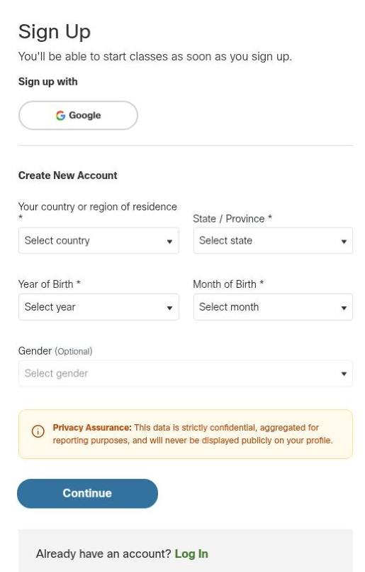](images/netacad-signup.jpg)

*Figure 2. The public registration entry screen. Complete your own details; required fields can vary by location.*

### Existing account sign-in

The captured **Login** screen starts with **Email** and **Login**, and also offers **Google**. With an email account, enter your email, select **Login**, then complete the authentication steps Cisco presents. A password field need not appear on the first screen. With Google, select **Google** and use the account associated with your Networking Academy profile.

[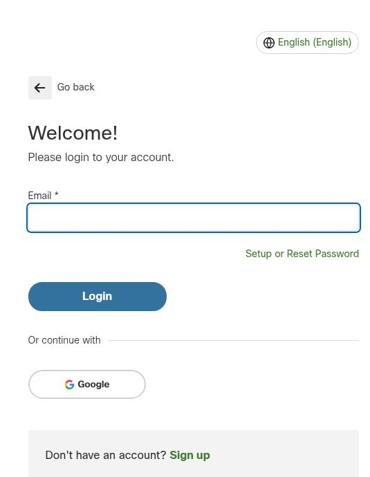](images/netacad-login.jpg)

*Figure 3. Use your existing account's sign-in method. Setup or Reset Password is available if needed.*

**Checkpoint:** You can sign in to Networking Academy. Keep the same account available for the course and Packet Tracer application.

## 3. Enroll in the free introductory course

1. Open [Getting Started with Cisco Packet Tracer](https://www.netacad.com/courses/getting-started-cisco-packet-tracer/1000).
2. Keep **Self-Paced Online** selected and choose your course language. The course is labeled **FREE** and **2 HOURS**.
3. Select **Get Started With Self-Paced**. If Cisco requests authentication, sign in using the account from Section 2, then return to the course and finish the enrollment prompts.
4. Open the enrolled course from your learning area. If you previously enrolled, use its continue or launch control rather than creating another account.
5. Locate **Module 1: Download and Use Cisco Packet Tracer**. Follow its download guidance or open the Resource Hub in Section 4.

[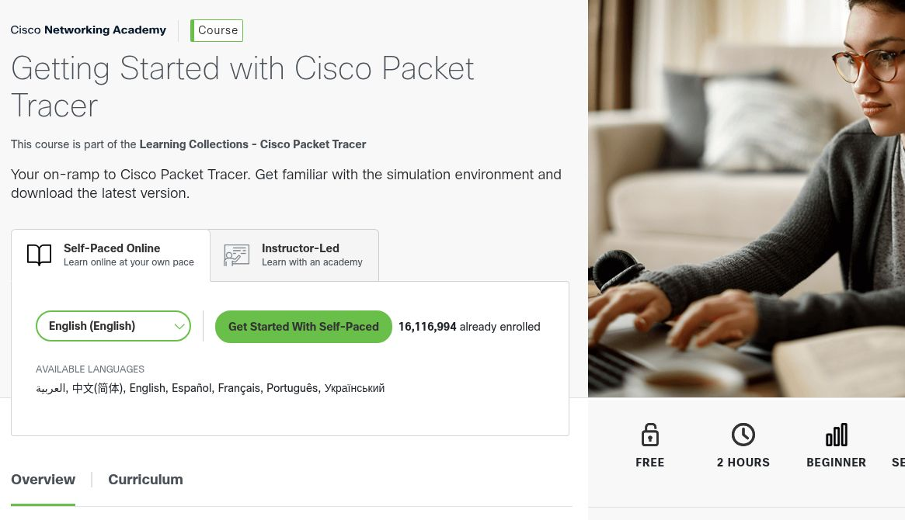](images/packet-tracer-course.jpg)

*Figure 4. Choose the free self-paced course. Cisco presents this course as the starting point for downloading Packet Tracer.*

The course provides free access to Packet Tracer. You do not need to purchase a subscription or enroll in a paid instructor-led class for this setup.

**Checkpoint:** The course is available in your account and you can find its download module.

## 4. Download the correct installer

1. Open Cisco's [Resource Hub and lab downloads](https://www.netacad.com/resources/lab-downloads).
2. If you see **Please login to download resources**, select **Login**. After authentication, return to the Resource Hub. Seeing the package names alone does not mean you are signed in.

    [](images/resource-hub.jpg)

    *Figure 5. The public Resource Hub entry page. Downloads require sign-in.*

3. Scroll to **Learning Resources → Cisco Packet Tracer**. Check the release number and the requirements beneath it.
4. For the Windows walkthrough, select **Packet Tracer 9.0.1 Windows 64bit**, or the equivalent Windows link for the current release. Choose **MacOS 64bit** or **Ubuntu 64bit** only for the corresponding supported operating system.
5. Let the browser finish downloading. In Windows, open **File Explorer → Downloads**, or open the browser's downloads list and choose **Show in folder**. If you chose another save location, open that folder instead.
6. The Windows installer is an `.exe` file, typically named like `CiscoPacketTracer_<version>_win_64bit.exe`. The version portion and punctuation may differ. Use the completed file downloaded from Cisco rather than looking for an exact filename elsewhere.

[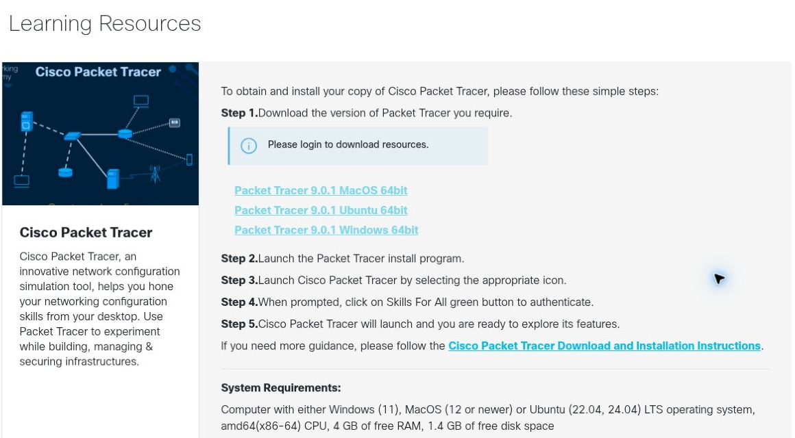](images/packet-tracer-downloads.jpg)

*Figure 6. Actual 9.0.1 operating-system choices on the public Resource Hub. This capture is signed out; authenticate to use the download links.*

Use these official Cisco destinations for the installer. This guide does not distribute the installation files.

**Checkpoint:** The download has finished and you know where the Windows `.exe` installer is saved.

## 5. Install on Windows

These steps follow Cisco's [Download and Installation Instructions](https://www.netacad.com/skillsforall/files/Cisco_Packet_Tracer_Download_and_Installation_Instructions.pdf). The installer screens themselves are not pictured here.

1. In **Downloads**, double-click the Packet Tracer `.exe` file. If Windows hides extensions, use the filename and **Application** file type to identify it. Do not open a partially downloaded file.
2. If Windows displays **User Account Control**, confirm that this is the Cisco installer you just downloaded and approve the installation. A managed computer may require an administrator to enter credentials.
3. If a welcome screen appears, select **Next**. Cisco's documented Windows sequence starts at **License Agreement**, so a separate welcome page may not appear.
4. Read the license agreement. If you accept its terms, select **I accept the agreement**, then **Next**.
5. At **Select Destination Location**, keep the default application folder unless you have a specific reason to change it. Select **Next**. This is where the program is installed, not where you must save lab files.
6. At **Select Start Menu Folder**, keep the default shortcut folder and select **Next**.
7. At **Select Additional Tasks**, choose whether to create additional shortcuts, such as a desktop shortcut. These do not change the simulated network. Select **Next**.
8. At **Ready to Install**, review the choices. Use **Back** to correct a setting, or select **Install** to copy the application files.
9. Wait for installation to finish. Leave **Launch Cisco Packet Tracer** selected if offered, then select **Finish**. Otherwise, open **Start**, search for **Cisco Packet Tracer**, and launch it.

If a multi-user startup question appears, choose **No** for these individual labs. Multi-user mode is for connecting Packet Tracer instances; it is not required for the local simulated networks in this series. A Windows network-access prompt may appear for related features. These labs do not require enabling multi-user connections or changing your computer's firewall rules.

**Checkpoint:** Packet Tracer starts and displays its authentication screen or workspace.

### macOS alternative

Use the macOS package offered for your supported Mac, and follow Cisco's linked installation instructions. Open the downloaded `.dmg`, open its installer, review the license, and follow **Continue → Install** as presented. Approve the macOS administrator prompt if required. Complete the installer and launch Packet Tracer from its folder in **Applications**. Check the current Resource Hub's processor requirements before assuming compatibility with an Apple silicon Mac.

### Ubuntu alternative

Cisco currently lists **Ubuntu 22.04 and 24.04 LTS**. Download its Ubuntu `.deb` package. Cisco documents installing the local package through `apt-get`; use the **actual downloaded filename** in place of the example below:

```bash
cd ~/Downloads
sudo apt-get install ./CiscoPacketTracer_<version>_Ubuntu_64bit.deb
```

Replace `<version>` and any other differing filename text before running the command; do not type the angle brackets literally. Press **Tab** and **Enter** to navigate the license prompts as described in [Cisco's installation instructions](https://www.netacad.com/skillsforall/files/Cisco_Packet_Tracer_Download_and_Installation_Instructions.pdf). Start Packet Tracer from the application menu or with `packettracer`. This is Ubuntu guidance; the availability of a `.deb` does not establish support for every Linux distribution.

## 6. First launch and authentication

1. Keep your Internet connection active and leave Packet Tracer open while signing in.
2. The login screen in Cisco's current [application Help](https://tutorials.ptnetacad.net/help/default/login.htm) uses a **LOGIN** button. Select it to open the browser-based sign-in process.
3. If your installed build instead offers separate **Cisco Networking Academy** and **Cisco Skills For All** buttons, Cisco's Resource Hub directs learners to **Skills For All**. Use your existing Networking Academy account; do not create another account merely because this older label appears.
4. If a **Login Server** selector is shown, leave the appropriate server for your account. **Worldwide** is shown in Cisco's Help example for the global site used in this guide.
5. In the browser, complete the same Cisco sign-in method used earlier. An existing browser session may authenticate automatically.
6. Wait for the browser to confirm successful Packet Tracer login. Cisco's installation instructions describe a success message saying that the tab may be closed. Return to Packet Tracer; closing the browser before success can leave the application waiting.
7. Confirm that the application's login panel has closed and the workspace is usable. An open browser or a completed software installation alone does not confirm application authentication.
8. Open **Help → About** in Packet Tracer to check the installed version. Compare it with the release you downloaded. Close the About window to return to the workspace.

[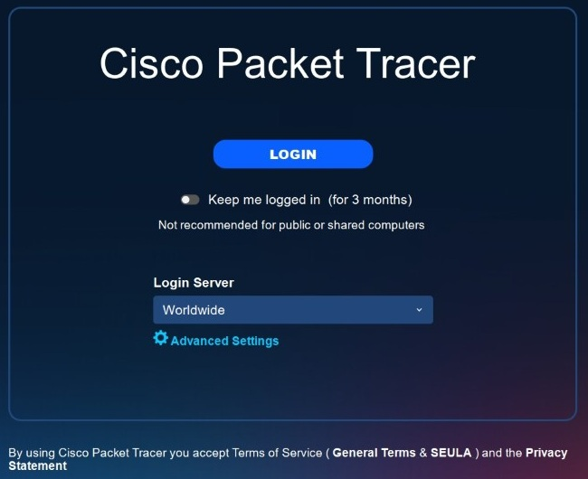](images/packet-tracer-login.jpg)

*Figure 7. Cisco Help's application login example, not a fresh 9.0.1 capture. Use LOGIN when this screen appears; website download text may still refer to the older Skills For All button.*

**Keep me logged in** retains access for the period shown by the application. Use it only on your own computer. Leave it disabled on shared computers, or sign out when finished.

### If sign-in does not finish

| What you see | What to do |
| --- | --- |
| Resource Hub still asks you to log in | Complete sign-in on Networking Academy, finish any profile prompts, and return to the Resource Hub. Open the free introductory course if you have not enrolled. |
| Packet Tracer is waiting but no browser appears | Check behind other windows and confirm that a default browser is configured. Retry LOGIN once with Packet Tracer still running. |
| Browser login succeeds but the application keeps waiting | Return to Packet Tracer, check for another login window, and retry from the application's login control. Confirm your computer's date and time and that the same account can sign in on Networking Academy. |
| External browser authentication still fails | If your version offers it, open **Advanced Settings** on the login panel and select **Use internal web browser for Cisco Networking Academy login**, then retry. This is Cisco's documented alternative. |
| Account or course access fails | Use **Setup or Reset Password** if appropriate, or the **Support** control on Networking Academy. Include the version and error message, without sending your password. |

[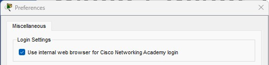](images/packet-tracer-login-settings.jpg)

*Figure 8. Cisco Help's internal-browser alternative. Use it only if this control exists in your installed version.*

**Checkpoint:** The Packet Tracer workspace is usable after sign-in and you have checked its version.

## 7. Find your way around Packet Tracer

### Workspace and operating modes

Select **Logical** near the upper left. This is the canvas where you place devices and draw their connections. **Physical** is a different view for arranging devices by physical location; begin these labs in Logical view.

At the lower right, find **Realtime** and **Simulation**. Start in **Realtime**. Simulation mode exposes an event list and playback controls for studying selected packets; it does not capture traffic from your physical computer.

[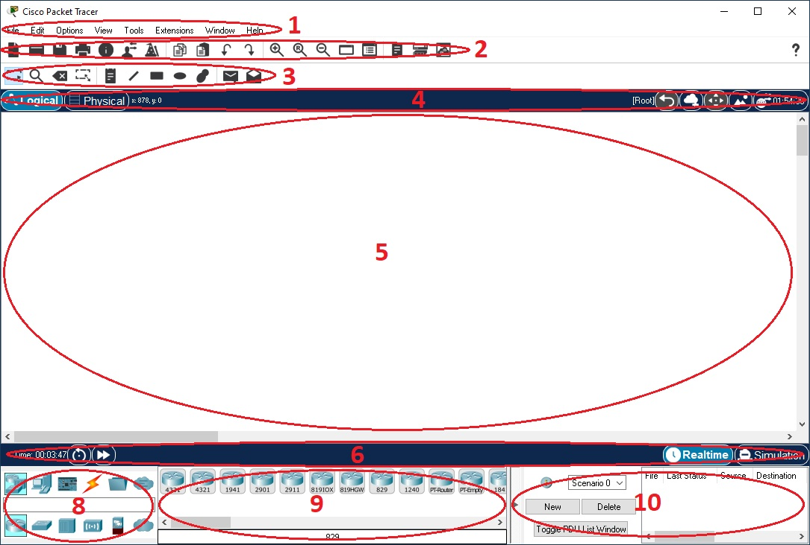](images/logical-workspace.jpg)

*Figure 9. Cisco Help's numbered interface example. Area 4 selects the workspace, 5 is the canvas, 6 selects the mode, and 7–9 contain the device-selection controls. This is a documentation example, not proof of a successful local sign-in.*

### Select routers, switches, and end devices

The **Network Component Box** is at the bottom left. Choose a device family, then a subcategory, then a model:

| What you need | Where to look | How you use it |
| --- | --- | --- |
| Router | **Network Devices → Routers** | Select a model, then select an empty spot on the canvas. Routers connect different networks. |
| Switch | **Network Devices → Switches** | Place a model on the canvas. Switches connect devices within a LAN. |
| PC or server | **End Devices** | Select a PC or server model and place it on the canvas. |
| Cable | **Connections**, the lightning-bolt category | Choose a cable type, then select an interface on each endpoint. |

Hover over a category or model to read its label. The available models change with the selected category. Use the device model required by each lab; interface names and available commands can differ between models.

[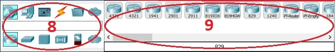](images/device-selection.jpg)

*Figure 10. Crop of Figure 9's original Cisco Help screenshot. Choose a family and subcategory before selecting a model.*

### Connect devices

1. Select **Connections** at the bottom left.
2. Hover over the cable icons to identify their types. Later labs will specify which to use; automatic selection is also available, but it does not teach cable recognition.
3. Select the required cable, then select the first device. Choose the interface named in the lab, such as **FastEthernet0** or **GigabitEthernet0/1**.
4. Select the second device and its required interface. If the interface is missing, check the model and cable type rather than substituting a random port.
5. Return to the **Select** tool or press **Esc** to leave the current placement operation. A cable drawn on the canvas does not prove that addressing or routing is correct. Link indicators may need time to settle.

[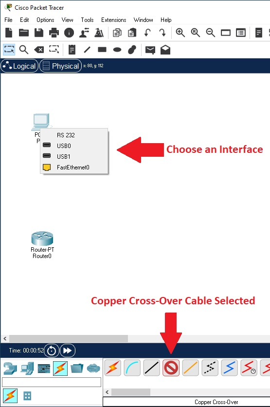](images/connections.jpg)

*Figure 11. Cisco Help's cabling example. It happens to use Copper Cross-Over; it is not a cable prescription for every connection. Each lab identifies its required cable and interfaces.*

### Open a device and find its configuration controls

Select a placed device with the **Select** tool to open its window. A router or switch commonly has **Physical**, **Config**, and **CLI** tabs. **Physical** shows its simulated hardware. **Config** provides graphical settings. **CLI** is the command-line interface for the Cisco commands used in later labs.

On the **CLI** tab, click inside the terminal and press **Enter** if a prompt has not appeared yet. If a new device asks whether to enter an initial configuration dialog, follow the lab's instructions; many CLI labs start by answering **no**. Typing into your Windows terminal does not configure the simulated router.

[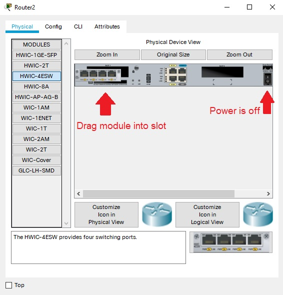](images/device-window.jpg)

*Figure 12. Cisco Help's router window example. The hardware shown is illustrative; use the lab's assigned model. Select CLI for command-line configuration.*

### Find PC Desktop and IP Configuration

1. Open a simulated **PC**, then select **Desktop**.
2. Select **IP Configuration** to set addressing. **Static** means entering the values yourself; **DHCP** requests them from a DHCP service in the simulated network. Later labs provide the correct values and method.
3. Locate **Command Prompt** on the same Desktop tab. This simulated prompt supports commands such as `ipconfig` and `ping` for checking the lab network. It is different from the router's CLI tab.

[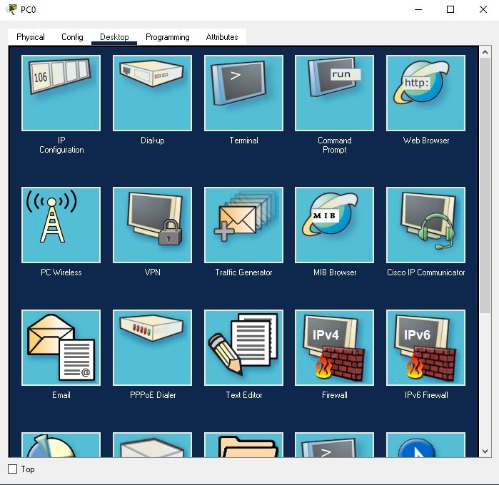](images/pc-desktop.jpg)

*Figure 13. Cisco Help's PC Desktop example. IP Configuration is the first icon at the upper left.*

[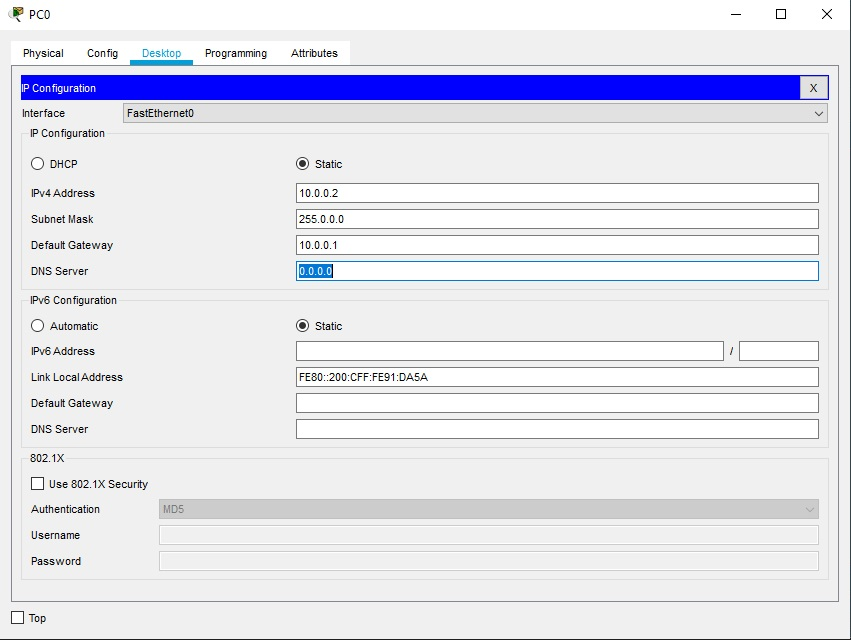](images/pc-ip-configuration.jpg)

*Figure 14. Cisco Help's IP Configuration example. The displayed addresses belong to Cisco's example; do not copy them into a different lab.*

### Save and open a .pkt file

1. Use **File → Save As**. Choose a folder you can find again, such as **Documents → Network+ Labs**; create the folder if needed.
2. Save an initial file as **packet-tracer-readiness.pkt** using the Packet Tracer `.pkt` format. An empty workspace is sufficient for this setup check; no network configuration is required here.
3. Confirm the filename in the application title bar or save dialog. Use **File → Open** to open that file again and confirm that it loads. Save future labs under their assigned filenames.
4. Use **File → Save** regularly while working. Saving the `.pkt` preserves the simulated topology and its state. When a later lab asks you to save a router's running configuration to startup configuration, perform that device command as well; saving the project and saving a device's startup configuration serve different purposes.

**Checkpoint:** You can find device categories, open device configuration windows, locate PC IP Configuration, and save and reopen a `.pkt` file.

## 8. Readiness checklist

- You have a free Cisco Networking Academy account and can sign in.
- Packet Tracer is installed on a computer that meets Cisco's requirements.
- You can authenticate in the application and check the installed version.
- You can open **Logical** view and select **Realtime** mode.
- You can locate routers, switches, PCs, servers, and connection tools.
- You can open a device's configuration window and find a router or switch **CLI** tab.
- You can locate a PC's **Desktop → IP Configuration**.
- You can create, save, and reopen a `.pkt` file.

Return to **Networking Labs** for the published activities in this series.

## Official sources and image attribution

- [Cisco Networking Academy](https://www.netacad.com/) and [Getting Started with Cisco Packet Tracer](https://www.netacad.com/courses/getting-started-cisco-packet-tracer/1000).
- [Resource Hub](https://www.netacad.com/resources/lab-downloads) and [Cisco's download and installation instructions](https://www.netacad.com/skillsforall/files/Cisco_Packet_Tracer_Download_and_Installation_Instructions.pdf).
- [Packet Tracer information and learning collection](https://www.netacad.com/catalogs/learn/cisco-packet-tracer).
- Cisco application Help: [login](https://tutorials.ptnetacad.net/help/default/login.htm), [interface overview](https://tutorials.ptnetacad.net/help/default/interfaceOverview.htm), [Logical workspace](https://tutorials.ptnetacad.net/help/default/workspace_logical.htm), and [PC configuration](https://tutorials.ptnetacad.net/help/default/config_PCs.htm).

Figures 1–6 are public Cisco website captures from October 29, 2026. Figures 7–14 reproduce or crop authentic screenshots from the linked Cisco Help pages; they are not locally executed application captures. Cisco website and application imagery belongs to Cisco and/or its affiliates. Captions identify the source and distinguish examples from steps you perform on your own computer.

[Back to Networking Labs](../README.md) · [Network+](../../../certifications/comptia/network-plus/README.md) · [Student Hub](../../../../README.md)
