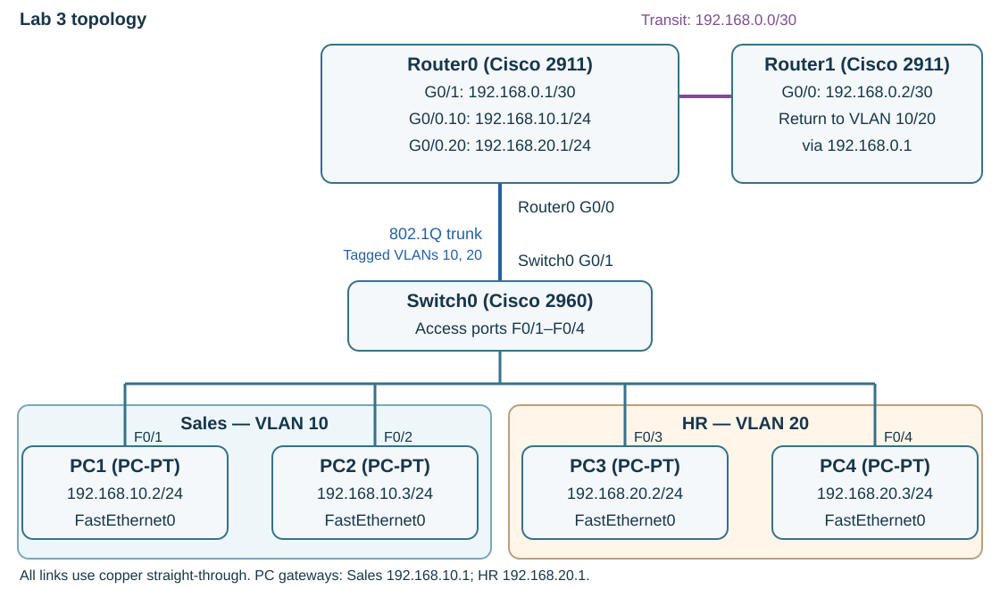

---
hub:
  kind: resource
template: article.html
---
# Lab 3 — Static Routing

Extend the completed VLAN network with a second router. Configure a /30 transit link and static routes on Router1 so replies can return to both VLANs behind Router0.

## Learning objectives

- Address and enable a router-to-router IPv4 link.
- Distinguish directly connected and static routes in a routing table.
- Configure and verify return paths, then compare static and dynamic routing conceptually.

## Before you begin

Complete [Lab 2 — VLAN Configuration](../vlan-configuration/README.md). Open **Lab2_VLAN_Configuration.pkt** and confirm that its same-VLAN and inter-VLAN pings work. Use the Packet Tracer release from the [setup guide](../packet-tracer-setup/README.md).

| Quantity | Device or material | Starting state |
| --- | --- | --- |
| 1 | Cisco 2911 Router0 | Retain its VLAN subinterfaces and existing cables |
| 1 | New Cisco 2911 Router1 | Add in this lab |
| 1 | Cisco 2960 Switch0 | Retain VLANs, access ports, and trunk from Lab 2 |
| 4 | PC1–PC4 | Keep their Lab 2 static addresses and gateways |
| 1 | New copper straight-through cable | Router0 GigabitEthernet0/1 → Router1 GigabitEthernet0/0 |

Only **static routing** is configured here. RIP, OSPF, and EIGRP are discussed at the end; do not enable them in this exercise.

## 1. Add Router1 and the transit link

1. Select **File → Save As** and create **Lab3_Static_Routing.pkt**. Keep your completed Lab 2 file.
2. Place another **Cisco 2911** from **Network Devices → Routers**. Keep its workspace display name **Router1**.
3. Use **Copper Straight-Through** to connect **Router0 GigabitEthernet0/1** to **Router1 GigabitEthernet0/0**. Router0's **G0/0** must remain connected to Switch0's trunk.

The 2911's Gigabit Ethernet hardware supports automatic crossover (**Auto-MDIX**), which is why this exercise uses a straight-through cable for this direct Ethernet link. Keep that cable and the specified models and ports for this lab. This does not mean straight-through cabling works on every pair of Ethernet interfaces; verify link state after enabling both ends.

| Link | First endpoint | Second endpoint | Cable |
| --- | --- | --- | --- |
| Existing trunk | Switch0 GigabitEthernet0/1 | Router0 GigabitEthernet0/0 | Existing copper straight-through |
| New transit | Router0 GigabitEthernet0/1 | Router1 GigabitEthernet0/0 | New copper straight-through |
| Existing clients | PC1–PC4 FastEthernet0 | Switch0 FastEthernet0/1–4, respectively | Existing copper straight-through |

[](images/topology.svg)

*Static-routing schematic. The new transit connection uses different Router0 hardware from the existing VLAN trunk. Select the image to enlarge it.*

### Addressing plan

| Device / interface | IPv4 address | Subnet mask | Default gateway |
| --- | --- | --- | --- |
| Router0 G0/1, new transit interface | 192.168.0.1 | 255.255.255.252 | Not configured for this lab |
| Router1 G0/0, new transit interface | 192.168.0.2 | 255.255.255.252 | Not configured for this lab |
| Router0 G0/0.10, Sales gateway | 192.168.10.1 | 255.255.255.0 | Not configured for this lab |
| Router0 G0/0.20, HR gateway | 192.168.20.1 | 255.255.255.0 | Not configured for this lab |
| PC1 FastEthernet0 | 192.168.10.2 | 255.255.255.0 | 192.168.10.1 |
| PC2 FastEthernet0 | 192.168.10.3 | 255.255.255.0 | 192.168.10.1 |
| PC3 FastEthernet0 | 192.168.20.2 | 255.255.255.0 | 192.168.20.1 |
| PC4 FastEthernet0 | 192.168.20.3 | 255.255.255.0 | 192.168.20.1 |

Router0's physical **G0/0** remains unaddressed and enabled underneath the VLAN subinterfaces. Do not change any VLAN addressing or switch port assignments.

### Why use a /30 here?

This point-to-point IPv4 link needs two host addresses. A **/30** mask, **255.255.255.252**, creates a four-address subnet with exactly two ordinary usable host addresses:

| Address | Role on 192.168.0.0/30 |
| --- | --- |
| 192.168.0.0 | Network address; not assigned to an interface |
| 192.168.0.1 | Router0 G0/1 |
| 192.168.0.2 | Router1 G0/0 |
| 192.168.0.3 | Broadcast address; not assigned to an interface |

The /30 is a suitable choice for this exercise; it is not a requirement for every real point-to-point network.

## 2. Configure both transit interfaces

### Router0

Open **Router0 → CLI**. From `Router>`, enter the following commands. If already at `Router#`, skip `enable`. Use `end` first if a previous configuration prompt is still open.

```console
enable
configure terminal
interface GigabitEthernet0/1
ip address 192.168.0.1 255.255.255.252
no shutdown
end
copy running-config startup-config
```

Press **Enter** at **Destination filename [startup-config]?**.

### Router1

Open **Router1 → CLI**. If its initial configuration dialog appears, answer `no` and continue to the CLI. From its `Router>` prompt, enter:

```console
enable
configure terminal
interface GigabitEthernet0/0
ip address 192.168.0.2 255.255.255.252
no shutdown
end
copy running-config startup-config
```

Press **Enter** at the destination filename prompt. Router0 and Router1 are workspace names; both default IOS prompts can still say `Router`. Confirm which device window you opened before entering commands.

At the privileged `Router#` prompt on **each router**, run:

```console
show ip interface brief
```

**Checkpoint:** Router0 **G0/1** shows **192.168.0.1**, up/up, and Router1 **G0/0** shows **192.168.0.2**, up/up. Router0's existing **G0/0.10** and **G0/0.20** should also remain up/up with their original gateway addresses.

On **Router1**, test the directly connected neighbor:

```console
ping 192.168.0.1
```

**Expected:** Replies after the link initializes and ARP resolves the neighbor. If this direct test fails, fix the transit interfaces before adding routes.

## 3. Add return routes on Router1

A **routing table** records the destination networks a router knows how to reach. An enabled, working interface supplies a **directly connected route** for its subnet. A **static route** is an administrator's explicit instruction for reaching a different destination network.

Router1 currently knows the **192.168.0.0/30** transit network. Add routes to the Sales and HR networks through its directly reachable neighbor, Router0 at **192.168.0.1**.

At **Router1's `Router#`** prompt, enter:

```console
configure terminal
ip route 192.168.10.0 255.255.255.0 192.168.0.1
ip route 192.168.20.0 255.255.255.0 192.168.0.1
end
copy running-config startup-config
```

Accept the startup-config destination with **Enter**.

| Part of an `ip route` command | Purpose |
| --- | --- |
| `192.168.10.0` or `192.168.20.0` | Destination **network**, rather than one PC's address. |
| `255.255.255.0` | Destination subnet mask; each VLAN network is a /24. |
| `192.168.0.1` | **Next hop**: the neighboring router to which Router1 sends the packet. It must be reachable. |

**Why only Router1 needs static routes:** Router0 already has directly connected routes to both VLAN networks and the transit network when those interfaces are up. Do not add static routes to those same networks on Router0. When PC1 or PC3 pings Router1, Router0 can deliver the request across the transit link, but **Router1 still needs a route back to the PC's subnet** for the reply.

## 4. Read the routing tables

At `Router#` on **Router1**, run:

```console
show ip route
```

The following is an **illustrative excerpt**, not output you should type. Formatting and additional entries can vary with the simulated IOS:

```console
C    192.168.0.0/30 is directly connected, GigabitEthernet0/0
L    192.168.0.2/32 is directly connected, GigabitEthernet0/0
S    192.168.10.0/24 [1/0] via 192.168.0.1
S    192.168.20.0/24 [1/0] via 192.168.0.1
```

**C** identifies a connected network; **L** identifies the router's own local interface address where that code is supported; **S** identifies a static route. In the static entries, `[1/0]` represents administrative distance and metric. The important checks here are the correct destination subnet and next hop.

On **Router0**, `show ip route` should show connected networks for **192.168.10.0/24** on **G0/0.10**, **192.168.20.0/24** on **G0/0.20**, and **192.168.0.0/30** on **G0/1**.

**Checkpoint:** Router1 has both **S** entries through **192.168.0.1**, and both routers have their expected connected routes. A configured static route may be absent from the active routing table if its next hop cannot be resolved, so check the transit link if an entry is missing.

### Routing-table interpretation

Using your own Router1 output:

1. Identify the connected transit network and distinguish it from Router1's own local /32 address, if shown.
2. Identify both static destination networks and their next-hop addresses.
3. Determine which entry forwards a reply destined for PC1 at `192.168.10.2`, then which entry forwards one for PC3 at `192.168.20.2`.
4. Trace each reply from Router1 to the PC, identifying the router interfaces and VLAN involved.

## 5. Verify end-to-end connectivity

1. Open **PC1 → Desktop → Command Prompt** and run the ping below.
2. On **PC3**, open the same tool and run the same ping.
3. Confirm that both PCs receive replies. Repeat once if ARP initialization causes an initial timeout; investigate persistent failures.

```console
ping 192.168.0.2
```

**Expected:** Both the Sales and HR networks can reach Router1 at **192.168.0.2**, and Router1 can return the replies. A working neighbor ping between routers alone does not establish this end-to-end result.

### Troubleshooting

Run these diagnostics from the appropriate router's privileged EXEC prompt:

| Device | Command | What to inspect |
| --- | --- | --- |
| Router0 | `show ip interface brief` | VLAN subinterfaces and G0/1 transit interface retain the correct addresses and are up/up. |
| Router1 | `show ip interface brief` | G0/0 is 192.168.0.2 and up/up. |
| Router1 | `show ip route` | Connected /30 and both static /24 routes through 192.168.0.1. |
| Either router | `show running-config` | Compare interface addresses, masks, and configured route statements with the lab. |
| Router1 | `show ip protocols` | Inspect routing-protocol information; this is **not** evidence that static routes are installed. |

No RIP, OSPF, or EIGRP process is configured in this lab. Use **`show ip route`** to verify static routes, rather than expecting `show ip protocols` to list them.

| Symptom | Check |
| --- | --- |
| Transit link is down | Verify the 2911 models, exact G0/1 ↔ G0/0 endpoints, cable, and `no shutdown` on both ends. An incorrect IP mask can break IP communication even when the physical link is up. |
| Neighbor ping fails | Check 192.168.0.1/30 and 192.168.0.2/30. Do not assign the .0 network or .3 broadcast address. |
| Router1 has no static entries | Verify the `ip route` commands in global configuration mode, then check whether 192.168.0.1 is reachable over the connected transit network. |
| PCs reach Router0 but cannot reach Router1 | Check the transit link and Router1's return routes to both VLAN networks. |
| Only one VLAN can reach Router1 | Check that Router1 has the matching route for that VLAN. Also recheck the failing PC's address, mask, gateway, access-port VLAN, and trunk. |
| Lab 2 pings stopped working | Confirm Router0's G0/0 trunk and subinterfaces were preserved. The new transit cable belongs on Router0 G0/1. |

## 6. Save and finish

1. If troubleshooting changed either router's configuration, save it again with `copy running-config startup-config` at `Router#`. Press **Enter** at the filename prompt. Switch0's saved Lab 2 configuration remains unchanged.
2. Select **File → Save** and confirm the project is **Lab3_Static_Routing.pkt**. Keep it as the starting point for the next activity when that activity is published.

### Static and dynamic routing

Static routing is useful for small, stable networks and specific paths where manually maintaining a few routes is practical. A topology change can require an administrator to change those routes. Dynamic routing protocols such as RIP, OSPF, and EIGRP exchange reachability information and can adapt routes to network changes. They add configuration and protocol behavior, but become useful as network size and redundancy grow. This lab's two explicit return routes require no dynamic protocol.

### Completion checklist

- Router1 is a 2911, connected from Router0 G0/1 to Router1 G0/0 with the assigned cable.
- The transit interfaces use 192.168.0.1/30 and 192.168.0.2/30 and are up/up.
- Router0's VLAN subinterfaces, Switch0's configuration, and the four PC configurations are preserved.
- Router1 has static routes to 192.168.10.0/24 and 192.168.20.0/24 through 192.168.0.1.
- PC1 and PC3 can both ping 192.168.0.2.
- Both routers' startup configurations and **Lab3_Static_Routing.pkt** are saved.

[Previous: Lab 2 — VLAN Configuration](../vlan-configuration/README.md) · [Back to Networking Labs](../README.md) · [Network+](../../../certifications/comptia/network-plus/README.md)
