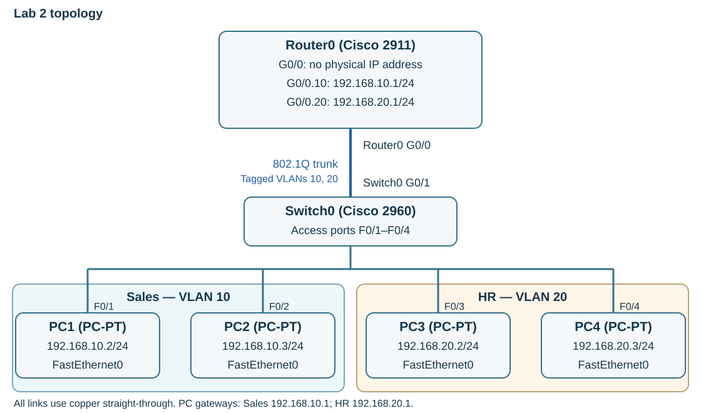

---
hub:
  kind: resource
template: article.html
---
# Lab 2 — VLAN Configuration

Continue your Lab 1 network. Add one PC, separate Sales and HR into VLANs, and configure Router0 to route between their subnets over one physical connection.

## Learning objectives

- Create VLAN 10 (Sales) and VLAN 20 (HR) and assign access ports.
- Configure an IEEE 802.1Q trunk and router subinterfaces.
- Verify both same-VLAN switching and inter-VLAN routing.

## Before you begin

Complete [Lab 1 — Basic Network Configuration](../basic-network-configuration/README.md). Open **Lab1_Basic_Network.pkt** and confirm its pings work before making changes. Use the same Packet Tracer release obtained through the [setup guide](../packet-tracer-setup/README.md).

| Quantity | Device or material | Starting state |
| --- | --- | --- |
| 1 | Cisco 2911 Router0 | Retain from Lab 1 |
| 1 | Cisco 2960 Switch0 | Retain from Lab 1 |
| 3 | PC1, PC2, PC3 | Retain from Lab 1 |
| 1 | New PC-PT, named PC4 | Add in this lab |
| 1 | New copper straight-through cable | Connect PC4 to Switch0 FastEthernet0/4 |

A **VLAN** is a logical Layer 2 network on a switch. Each VLAN is a separate **broadcast domain**: its Ethernet broadcasts remain within that VLAN. An **access port** carries a PC's traffic in one assigned VLAN. A **trunk** carries multiple VLANs, using 802.1Q tags to identify tagged frames' VLANs. The VLAN 10 and 20 traffic in this lab is tagged on the trunk.

## 1. Update the topology and plan

1. Select **File → Save As** and create **Lab2_VLAN_Configuration.pkt** before editing. Keep the completed Lab 1 file.
2. Add one PC-PT and set its **Config → Display Name** to **PC4**. Because earlier PCs were renamed, check the new display name rather than relying on automatic numbering.
3. Connect **PC4 FastEthernet0** to **Switch0 FastEthernet0/4** using **Copper Straight-Through**.
4. Leave every Lab 1 cable connected to its original port.

| Client endpoint | Switch access port | Assigned VLAN |
| --- | --- | --- |
| PC1 FastEthernet0 | FastEthernet0/1 | 10 — Sales |
| PC2 FastEthernet0 | FastEthernet0/2 | 10 — Sales |
| PC3 FastEthernet0 | FastEthernet0/3 | 20 — HR |
| PC4 FastEthernet0 | FastEthernet0/4 | 20 — HR |

The router-facing link remains **Switch0 GigabitEthernet0/1 ↔ Router0 GigabitEthernet0/0**. It will become the trunk; do not use a PC's access port for it.

[](images/topology.svg)

*Router-on-a-stick schematic. One physical switch-to-router link carries both VLANs. Select the image to enlarge it.*

### IPv4 addressing plan

| Device / interface | VLAN | IPv4 address | Subnet mask | Default gateway |
| --- | --- | --- | --- | --- |
| Router0 G0/0.10 | 10 | 192.168.10.1 | 255.255.255.0 | Not configured for this lab |
| Router0 G0/0.20 | 20 | 192.168.20.1 | 255.255.255.0 | Not configured for this lab |
| PC1 FastEthernet0 | 10 | 192.168.10.2 | 255.255.255.0 | 192.168.10.1 |
| PC2 FastEthernet0 | 10 | 192.168.10.3 | 255.255.255.0 | 192.168.10.1 |
| PC3 FastEthernet0 | 20 | 192.168.20.2 | 255.255.255.0 | 192.168.20.1 |
| PC4 FastEthernet0 | 20 | 192.168.20.3 | 255.255.255.0 | 192.168.20.1 |

Router0's physical **GigabitEthernet0/0** will have **no IP address**. Its subinterfaces provide the two gateways. The old 192.168.1.0/24 client settings must change because the two new VLANs use different IP subnets.

## 2. Create VLANs and assign access ports

Open **Switch0 → CLI**. At `Switch>`, enter the commands below. Code blocks contain commands only. The switch's prompt may say `Switch` even though its workspace display name is Switch0.

```console
enable
configure terminal
vlan 10
name Sales
exit
vlan 20
name HR
exit
interface FastEthernet0/1
switchport mode access
switchport access vlan 10
exit
interface FastEthernet0/2
switchport mode access
switchport access vlan 10
exit
interface FastEthernet0/3
switchport mode access
switchport access vlan 20
exit
interface FastEthernet0/4
switchport mode access
switchport access vlan 20
exit
end
```

`vlan` selects VLAN configuration mode, where `name` sets the label. On an interface, `switchport mode access` establishes a PC-facing access port and `switchport access vlan` assigns its VLAN. `end` returns to privileged EXEC mode, `Switch#`.

At `Switch#`, run:

```console
show vlan brief
```

**Checkpoint 1:** VLAN **10 Sales** includes **Fa0/1** and **Fa0/2**; VLAN **20 HR** includes **Fa0/3** and **Fa0/4**. Other unused ports can remain in VLAN 1. Connectivity is not ready for testing until the trunk, router, and PC steps are finished.

## 3. Configure the router-facing trunk

At **Switch0's `Switch#`** prompt, enter:

```console
configure terminal
interface GigabitEthernet0/1
switchport mode trunk
end
copy running-config startup-config
```

At **Destination filename [startup-config]?**, press **Enter**. Then run:

```console
show interfaces trunk
```

**Checkpoint 2:** **Gi0/1** is trunking with **802.1Q** encapsulation. VLANs **10** and **20** should be active and forwarding on that trunk after initialization. Allow time for spanning tree to settle. The fresh switch's default allowed list can include other VLANs; this command does not restrict it to only 10 and 20. There is no need to add an allowed-VLAN list or change the default native VLAN for this lab.

The selected 2960 uses 802.1Q for this trunk. No separate trunk-encapsulation selection command is needed on this model. `show vlan brief` lists access-port membership; use `show interfaces trunk` to check the trunk rather than expecting it in the access-port list.

## 4. Configure Router0's subinterfaces

Different VLANs cannot communicate through Layer 2 switching alone. Router0 provides the Layer 3 forwarding between the two IP networks. **Router-on-a-stick** uses one physical interface and a separate logical **subinterface** for each VLAN.

Open **Router0 → CLI**. From `Router>`, enter `enable`; if already at `Router#`, continue with `configure terminal`:

```console
enable
configure terminal
interface GigabitEthernet0/0
no ip address
no shutdown
exit
interface GigabitEthernet0/0.10
encapsulation dot1Q 10
ip address 192.168.10.1 255.255.255.0
exit
interface GigabitEthernet0/0.20
encapsulation dot1Q 20
ip address 192.168.20.1 255.255.255.0
exit
end
copy running-config startup-config
```

Press **Enter** at the startup-config destination prompt.

`no ip address` removes the **192.168.1.1/24** address inherited from Lab 1. Keep the parent interface enabled with `no shutdown`. The `.10` and `.20` suffixes are local subinterface numbers, commonly chosen to match VLAN IDs. **`encapsulation dot1Q 10`** and **`encapsulation dot1Q 20`** actually associate the subinterfaces with the VLANs; the suffix alone does not do so.

At `Router#`, run:

```console
show ip interface brief
```

**Checkpoint 3:** **G0/0** is **unassigned** and up/up. **G0/0.10** is **192.168.10.1** and up/up; **G0/0.20** is **192.168.20.1** and up/up. A subinterface's up/up state alone does not prove that switch VLAN assignments and tags are correct, so continue with the host tests.

## 5. Replace the PCs' old addresses

1. Open each PC's **Desktop → IP Configuration** and keep **Static** selected.
2. Replace its Lab 1 address, mask, and gateway with the values in this lab's addressing plan. Set PC4's values as well.
3. On every PC, open **Desktop → Command Prompt** and run `ipconfig` to check the result. DNS is not needed for these IP-based tests.

**Checkpoint 4:** PC1 and PC2 use the **192.168.10.0/24** subnet and gateway **192.168.10.1**. PC3 and PC4 use **192.168.20.0/24** and gateway **192.168.20.1**. No client should retain a **192.168.1.x** address.

## 6. Verify switching and routing

1. On **PC1 → Desktop → Command Prompt**, run the PC1 block below.
2. On **PC3**, open the same tool and run its block.

**PC1:**

```console
ipconfig
ping 192.168.10.3
ping 192.168.20.2
```

**PC3:**

```console
ping 192.168.20.3
```

| Checkpoint | Test | Expected result and path |
| --- | --- | --- |
| 5: Same-VLAN communication | PC1 → 192.168.10.3 (PC2) | Replies; Switch0 forwards within Sales VLAN 10. |
| 5: Same-VLAN communication | PC3 → 192.168.20.3 (PC4) | Replies; Switch0 forwards within HR VLAN 20. |
| 6: Inter-VLAN communication | PC1 → 192.168.20.2 (PC3) | Replies; PC1 sends to its gateway, and Router0 routes the traffic into VLAN 20. |

For the inter-VLAN test, traffic crosses the same trunk toward Router0 in VLAN 10 and returns across it in VLAN 20. This is normal router-on-a-stick operation. VLAN separation limits Layer 2 broadcasts; it does not by itself block communication that a router permits. A first ping may lose a reply while ARP resolves a next hop, so repeat it once before investigating a persistent failure.

### Troubleshooting

| Symptom | Check |
| --- | --- |
| Same-VLAN ping fails | Confirm the two addresses and /24 masks; use Switch0 `show vlan brief` to check both access ports. Check the cables and link status. |
| Same-VLAN tests work but inter-VLAN fails | Check both PC gateways, Switch0 `show interfaces trunk`, and Router0 `show ip interface brief`. Review the dot1Q VLAN numbers in Router0 `show running-config`. |
| No trunk is listed | Confirm **Switch0 G0/1 → Router0 G0/0**, enter `switchport mode trunk` on **Switch0 G0/1**, and confirm the router's parent interface is enabled. |
| A subinterface is down | Check the parent G0/0 interface and its physical link. `no shutdown` must be applied to that parent. |
| G0/0 still shows 192.168.1.1 | Remove the old physical-interface address with `no ip address` under G0/0. Use the two subinterface addresses from the plan. |
| A `show` command fails in configuration mode | Enter `end` first. Switch verification belongs at `Switch#`; router verification belongs at `Router#`. |

## 7. Save and finish

1. If you corrected device settings, run `copy running-config startup-config` at the privileged prompt on **both Switch0 and Router0**. Accept each filename with **Enter**.
2. Select **File → Save** and confirm the project is **Lab2_VLAN_Configuration.pkt**. Keep Lab 1's file as a separate checkpoint.

### Completion checklist

- PC4 is connected to Switch0 Fa0/4; the earlier cables have not moved.
- Sales VLAN 10 contains Fa0/1–2, and HR VLAN 20 contains Fa0/3–4.
- Switch0 Gi0/1 trunks to Router0 G0/0 using 802.1Q.
- Router0's physical G0/0 is unaddressed and enabled; its subinterfaces have the two correct gateway addresses and VLAN tags.
- All four PCs use the addressing plan, and both same-VLAN tests and the inter-VLAN test succeed.
- Switch0 and Router0 startup configurations and **Lab2_VLAN_Configuration.pkt** are saved.

[Next: Lab 3 — Static Routing](../static-routing/README.md)

[Previous: Lab 1 — Basic Network Configuration](../basic-network-configuration/README.md) · [Back to Networking Labs](../README.md) · [Network+](../../../certifications/comptia/network-plus/README.md)
