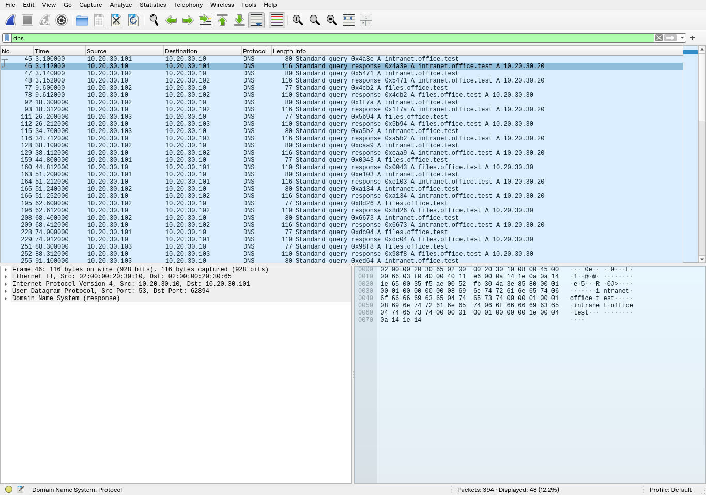
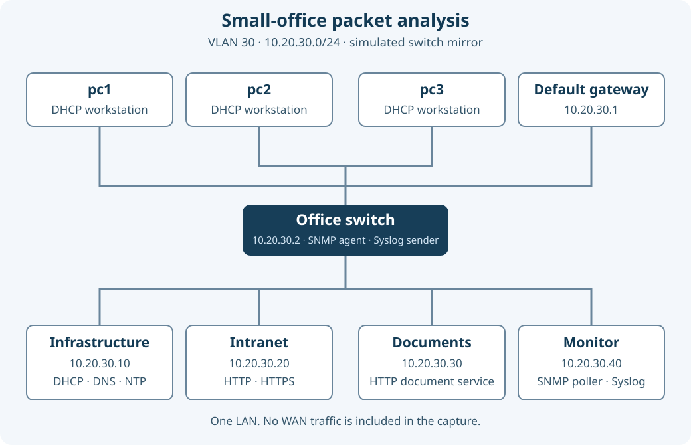
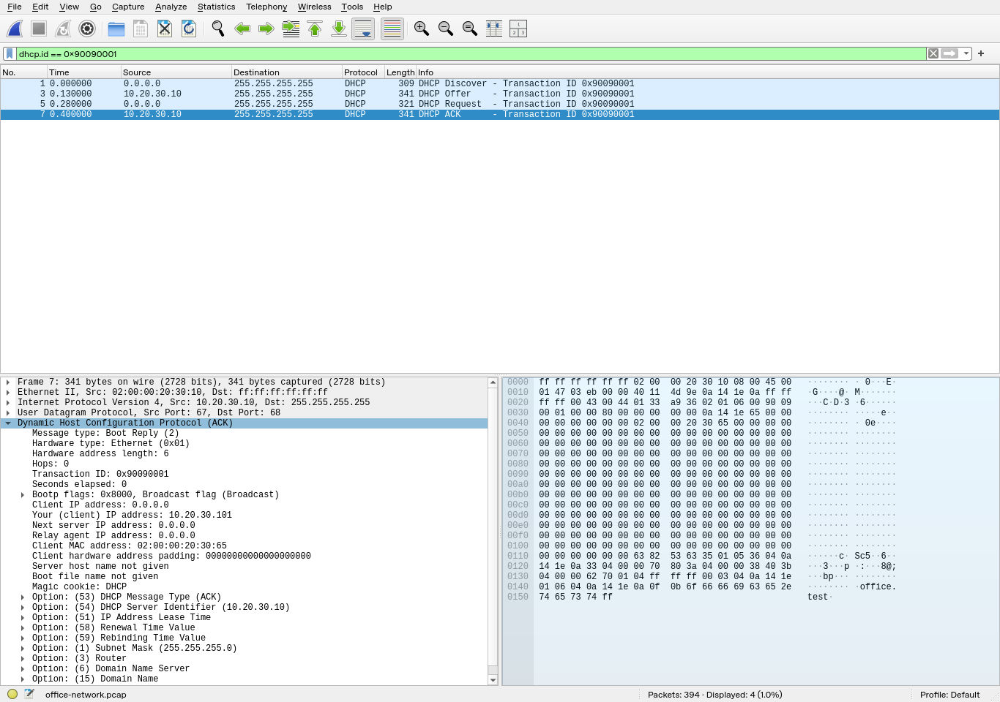
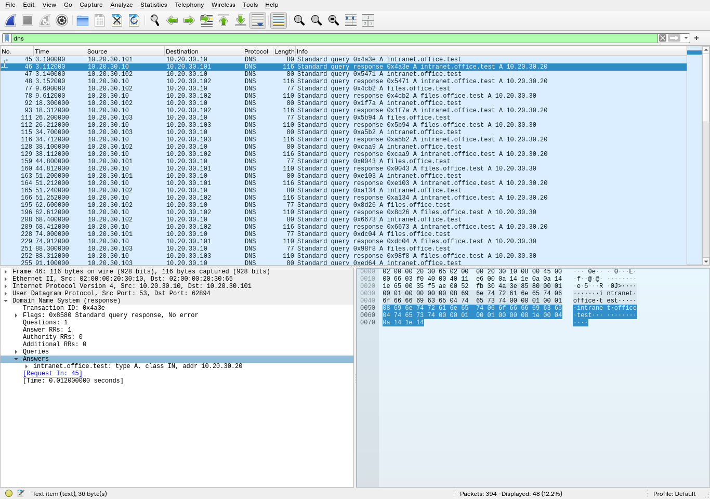
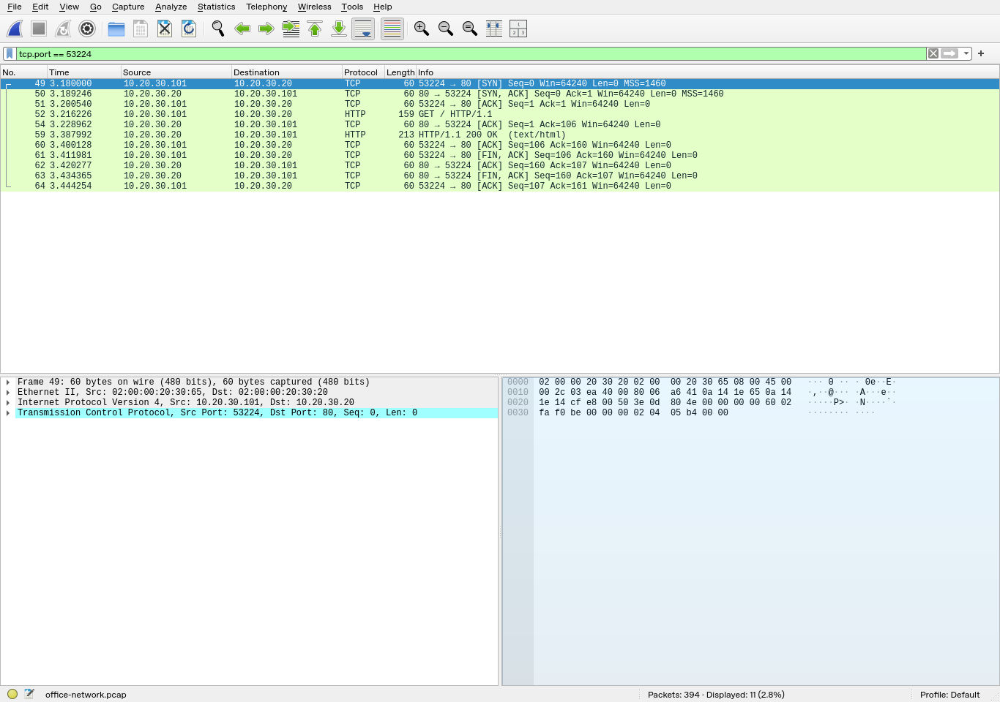
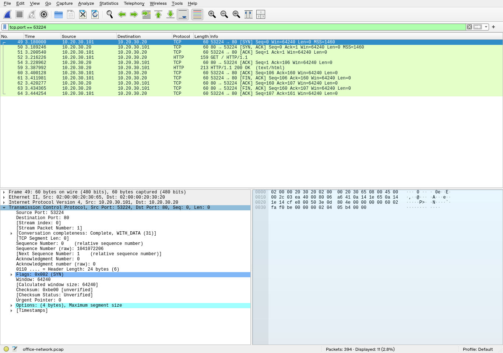
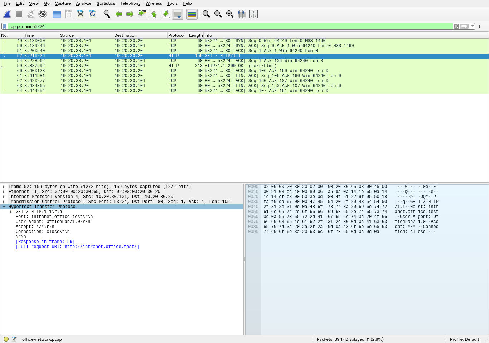
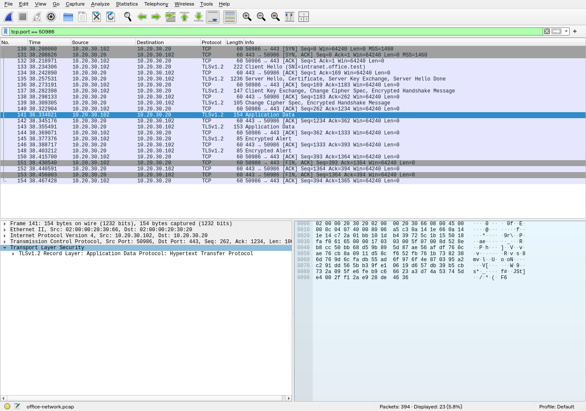
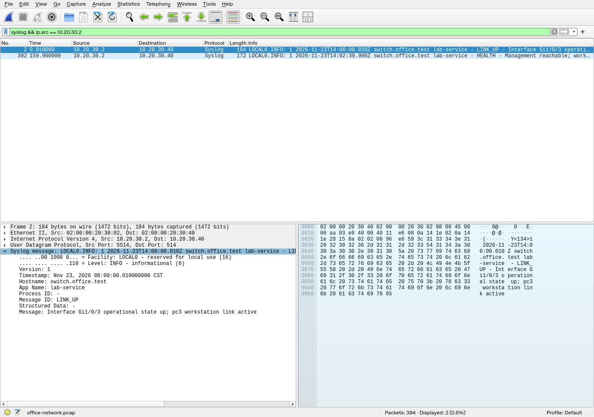

# Wireshark Packet Analysis Lab

Explore a small-office network one packet at a time. Select frames, expand fields, apply display filters, and connect familiar services to their traffic. The main activity takes **20–30 minutes**, after installation. The optional investigation adds **5–10 minutes**.

**Download:** [office-network.pcap](assets/office-network.pcap) · [office-network.log](assets/office-network.log)

Need the application? Start with [Wireshark: Install and Explore](../../../tools/wireshark/README.md). Use a Windows 11 PC with the current stable Wireshark release. No live capture, shared classroom network, or administrator capture privileges are required.

The dataset contains **394 packets over approximately 2 minutes 40 seconds**. It is **simulated small-office traffic**, with genuine OpenSSL-generated TLS records, rather than a production-network recording. All names and devices are fictional. Your own network configuration does not affect the evidence.

## Open the capture

1. Select the capture download and save it in **Downloads**. If GitHub shows a file page, choose **Download raw file**. Save the `.log` too; if it opens as text, use the browser's **Save as** command and preserve the `.log` extension. Do not copy either file into a Word document.
2. Open Wireshark and select **File → Open** or **Ctrl+O**. Choose `office-network.pcap` from Downloads, then **Open**. Do not start a capture on an adapter.
3. Confirm the status bar reports **394 packets**. If a download was saved as HTML, download the raw file again. Open `office-network.log` in **Notepad** when the bonus asks for logs; it is not a second capture file.
4. In the display filter field, enter `dns` and press **Enter**. Observe the displayed count, then select the clear **X**. A display filter hides rows without deleting them. A capture filter instead limits what is collected during a live capture; it is not used here.
5. Choose **View → Time Display Format → Seconds Since First Captured Packet**. Frame numbers refer to the original **No.** column, not positions within filtered results. Use **Go → Go to Packet** or **Ctrl+G** to jump to a frame. Clear a filter if it hides the target.

*Figure 1. Apply a display filter with Enter. Clearing it restores the complete list. Select any image to open its full resolution.*

**Image note:** screenshots show the actual supplied capture in Linux Wireshark **4.4.19**. The Windows installation guide targets the current stable release. Themes and labels can differ. The [interface overview](../../../tools/wireshark/README.md#2-find-your-way-around) identifies the panes and columns.

## The example network

*Figure 2. The dataset models a switch mirror of bidirectional VLAN traffic. A normal capture on your own PC would not necessarily see all these conversations.*

| Device | Address and role |
| --- | --- |
| pc1, pc2, pc3 | DHCP clients; inspect their assigned settings |
| Gateway | `10.20.30.1`; default route out of the local network |
| Switch | `10.20.30.2`; SNMP monitoring and Syslog messages |
| Infrastructure server | `10.20.30.10`; DHCP, DNS, and NTP |
| Intranet server | `10.20.30.20`; HTTP and HTTPS |
| Document server | `10.20.30.30`; internal HTTP document service |
| Monitor | `10.20.30.40`; SNMP polling and Syslog collection |

There is no WAN traffic here. Local client/server exchanges do not need to pass through the gateway.

## Activity A: select and read a packet (3 minutes)

1. Clear the filter and select frame **52**. Find its Source, Destination, Protocol, Length, and Info columns.
2. Expand **Ethernet II**, **Internet Protocol Version 4**, **Transmission Control Protocol**, and **Hypertext Transfer Protocol** in Packet Details. Select a field and watch its bytes highlight in Packet Bytes. Collapse branches to make space.
3. Select frame **7**. Expand **Dynamic Host Configuration Protocol**, then its **Subnet Mask** and **Router** options. These options supply configuration, not ordinary packet destinations.

**A1.** For frame 52, record the sender and receiver IPv4 addresses. Which device is making the request?

**A2.** Using frame 7's assigned address and mask, record the local subnet in CIDR notation and the default gateway. Identify the option that supplies the gateway.

## Activity B: ARP and local delivery (2 minutes)

1. Apply `arp`. Select frames **14** and **15** in turn.
2. Expand **Ethernet II** and **Address Resolution Protocol**. Compare the destination Ethernet addresses. Locate the ARP sender/target IP and MAC fields.

**B1.** Which frame is a broadcast request, which is a unicast reply, and what IP-to-MAC mapping does the reply supply? Why is this local exchange needed before sending to that next hop?

## Activity C: DHCP settings (3 minutes)

1. Apply `dhcp.id == 0x90090001`. The four relevant frames are **1, 3, 5, and 7**.
2. Expand **Dynamic Host Configuration Protocol** in each. Find **Option (53) DHCP Message Type**. The BOOTP **Message type: Boot Request/Reply** field is different; it does not distinguish Discover from Request by itself.
3. Compare **Requested IP Address** in frame 5 with **Your (client) IP address** and the options in frame 7. Expand **User Datagram Protocol** to inspect ports.

*Figure 3. Follow one transaction ID and inspect the DHCP message-type option.*

**C1.** Match the four frames to Discover, Offer, Request, and Acknowledge. What address did the client request and receive?

**C2.** Record the client's DNS server and lease duration. Which UDP port belongs to the DHCP server and which to the client?

## Activity D: DNS questions and answers (3 minutes)

1. Apply `dns`. Select frame **45**, then **46**.
2. Expand **User Datagram Protocol** and **Domain Name System**. Compare transaction IDs, **Queries**, **Flags**, and **Answers**. Expand the record under Answers. The address/port pairs reverse for the reply.

*Figure 4. DNS Details separates the question, reply flags, and returned records.*

**D1.** What name and record type were requested? What address returned, and which fields confirm a successful reply to the same question?

**D2.** What are the client's source port and server destination port in the query? Explain the source port's role when the response arrives.

## Activity E: TCP, then readable HTTP (5 minutes)

1. Apply `tcp.port == 53224`. Observe frames **49, 50, and 51** before application data. **SYN** begins TCP setup, **SYN/ACK** replies to it, and **ACK** completes the three-way handshake. TCP's Flags field identifies these functions.
2. Select frame **49** and expand **Transmission Control Protocol**. Find both ports, sequence/acknowledgment fields, and **Flags**. Wireshark normally displays relative sequence numbers to simplify reading.

*Figure 5. Follow the same endpoint port pair through setup, data, and closing.*

*Figure 6. Ports identify application endpoints; flags describe TCP control behavior.*

3. Select frame **52**, collapse TCP if needed, and expand **Hypertext Transfer Protocol**. Find the request line and Host header. Select frame **59** for its HTTP status line. Frame **61** starts closing.

*Figure 7. Unencrypted HTTP text is readable inside the TCP payload.*

**E1.** Record the three setup frames and flags, both endpoint ports, and the closing flag in frame 61. Which endpoint initiated the connection?

**E2.** What request method and Host value appear in frame 52? What status code returns in frame 59?

**E3.** Why can frames 49–51 be TCP packets without being HTTP requests? Explain the jobs of TCP and HTTP.

## Activity F: TLS and HTTPS visibility (3 minutes)

1. Apply `tcp.port == 50986` for the first HTTPS conversation, or `tcp.port == 443` for both. Compare TCP setup in frames **130–132** with TLS handshake frames **133** and **135**.
2. Expand **Transport Layer Security** in frame 133 and its Client Hello record. Inspect frame 135's Server Hello and certificate records. Then inspect **141** and **143**, labeled **Application Data**.

*Figure 8. A TLS record's application label does not mean its HTTP contents have been decrypted.*

**F1.** Which frame is the Client Hello, which is the Server Hello, and what TLS version is selected? Record the transport and server port.

**F2.** Which addressing, port, and handshake information remains visible? Can you read the HTTP request in frame 141 as you could in frame 52? Explain what is missing for that analysis.

## Activity G: ICMP and other services (4 minutes)

1. Apply `icmp`. Compare frames **71** and **72**. Expand **Internet Control Message Protocol** and compare type, identifier, and sequence fields. ICMP has no TCP or UDP ports.
2. Briefly inspect these exchanges. Expand the application protocol beneath its transport header; do not decode every byte.

| Exchange | Filter | Frames | Fields to find |
| --- | --- | --- | --- |
| Time synchronization | `ntp` | **75, 76** | Client/server mode; transmit and originate timestamps |
| Device monitoring | `snmp` | **73, 74** | GetRequest/GetResponse; request ID; returned value |
| Switch logging | `syslog && ip.src == 10.20.30.2` | **2, 392** | Hostname, severity, Message ID, and message |

*Figure 9. Logs add the device's own event description. The saved log uses UTC timestamps ending in Z; Wireshark may format decoded timestamps in your local timezone.*

**G1.** Which ICMP frame requests a reply and which answers it? What does success establish, and what application behavior does it leave untested?

**G2.** What service do frames 75–76 represent? Identify its transport, server port, and timestamp field that ties the response to the request.

**G3.** What device and value are monitored in frames 73–74? Identify the transport, agent port, and matching request identifier.

**G4.** For frame 2, identify the sender, collector, server port, severity, and event. What does the message tell you that the UDP header cannot?

**SMB comparison:** SMB file sharing commonly uses TCP **445**. Applying `tcp.port == 445` returns no packets here. This dataset's document service uses HTTP. A familiar port number alone is not evidence of an SMB exchange.

## Useful display filters

These expressions were checked against the supplied capture. A valid expression can correctly match zero packets. Where a row lists two alternatives, apply one at a time.

| Expression | What it shows |
| --- | --- |
| `arp` | ARP requests and replies |
| `dhcp` | DHCP; use this current name rather than an older BOOTP alias |
| `dns` | Decoded DNS traffic |
| `icmp` | ICMP messages |
| `tcp` or `udp` | Packets carrying the chosen transport |
| `http` or `tls` | Decoded application traffic; excludes pure TCP acknowledgments |
| `tcp.port == 443` | Both directions of TCP conversations using port 443, including setup/closing |
| `tcp.port == 445` | No matches here; conventional direct-hosted SMB uses this port |
| `udp.port == 123` | UDP using the usual NTP server port |
| `udp.port == 161` | UDP using the usual SNMP agent port |
| `udp.port == 514` | UDP using the conventional Syslog port |
| `ip.addr == 10.20.30.101` | IPv4 packets to/from pc1; ARP is not IPv4 |
| `tcp.flags.syn == 1` | SYN-bearing packets, including SYN/ACK replies |

A **protocol filter** asks what Wireshark decoded. A **port filter** matches a header number. Services can run on other ports, and other applications can use familiar ports; a port alone does not guarantee a protocol.

## Bonus: Troubleshooting Investigation

**Optional, 5–10 minutes.** A user reports that the internal document page briefly failed to open, then worked on retry. Other network activity continued. Investigate evidence around **70–86 seconds** and compare it with `office-network.log` in Notepad.

Start with `ip.addr == 10.20.30.30`. Use `dns`, `tcp`, or `syslog` as needed. In the log, UTC **14:01:10–14:01:26** corresponds to relative seconds 70–86. A local-time display may differ; compare the UTC Z timestamp in message text or the relative capture Time column.

Record your evidence before opening the answer sheet:

1. **Observed symptom:** what failed from the client's perspective?
2. **Packet evidence:** record frame numbers, times, endpoint addresses/ports, DNS result, and TCP behavior. Compare the failed attempt with the later successful exchange.
3. **Log evidence:** identify matching log lines and events. Separate recorded events from your inference.
4. **Diagnosis:** state the narrowest conclusion supported by both sources. Does name resolution, a silent connectivity failure, or application availability best fit? State anything the capture cannot establish.
5. **Next step:** propose verification or remediation and the result that would confirm recovery.

## Finish and review

- [Answers and Explanations](answers.md)

    After completing the activity, compare your observations with verified frames, fields, explanations, and the bonus timeline.

- [Ports & Protocols Reference](../../../reference/ports-and-protocols.md)

    Review service purposes and transport ports.

You are finished when you can filter, select a frame, explain its endpoints, identify a request/response exchange, and distinguish readable data from encrypted content.

[Back to Networking Labs](../README.md) · [Wireshark Setup](../../../tools/wireshark/README.md) · [Network+](../../../certifications/comptia/network-plus/README.md) · [Student Hub](../../../../README.md)
