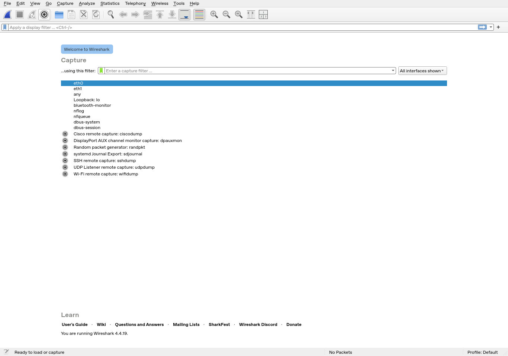
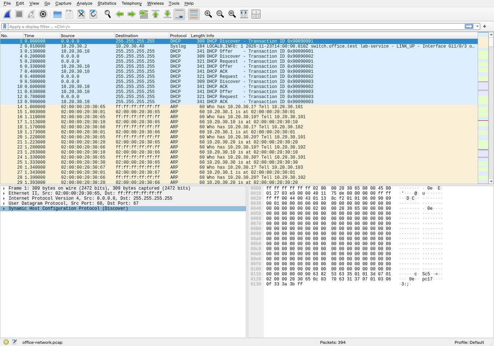
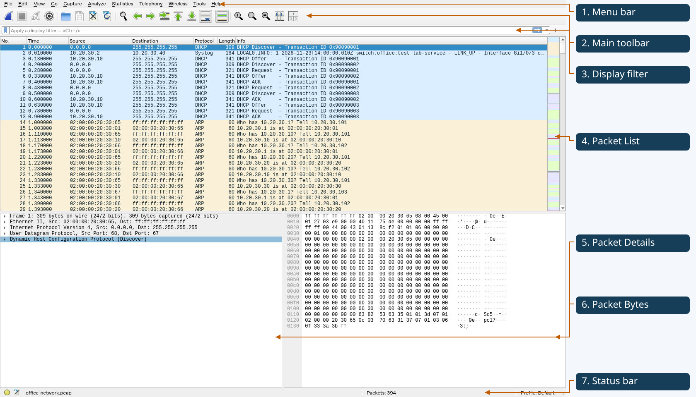

# Wireshark: Install and Explore

Wireshark is a free, open-source **network protocol analyzer**. It captures network packets or opens saved captures, then decodes their headers and application data. Use it to understand protocol exchanges, diagnose communication problems, and recognize unexpected activity. A packet trace is evidence to interpret; a colored row alone is not a diagnosis.

This guide prepares you for the [Wireshark Packet Analysis Lab](../../labs/networking/wireshark/README.md). The lab supplies a small-office capture. You do not need to capture your home network or connect to another student's network.

## 1. Install on Windows 11

You need Internet access to download Wireshark and permission to install software. After downloading the lab files, you can analyze them offline using a normal user account. Opening a saved capture does not require Npcap, an active capture interface, or administrative **capture** privileges. The installer itself may require administrator approval.

**Release checked November 23, 2026:** the [official download page](https://www.wireshark.org/download.html) lists **Stable Release 4.6.10**. Choose the current **Stable Release** if this changes. Avoid the development/release-candidate section. These instructions use controls shared across recent stable releases.

1. Open [wireshark.org/download.html](https://www.wireshark.org/download.html).
2. Under **Stable Release**, choose **Windows x64 Installer** for an Intel or AMD Windows 11 PC, or **Windows Arm64 Installer** for an Arm-based PC. If unsure, check **Settings → System → About → System type**. Choose an installer rather than the source-code archive or PortableApps package for this walkthrough.
3. Open **File Explorer → Downloads** and run the completed Wireshark `.exe` file. Confirm the publisher is **Wireshark Foundation** when Windows asks for installation approval. A managed PC may require an administrator.
4. Read the license and proceed if you accept it. Keep the standard Wireshark components and installation folder unless your organization specifies otherwise. Continue through the shortcut and file-association choices.
5. If offered **Install Npcap**, understand its purpose: Npcap is the Windows packet-capture driver used to collect **live traffic** from network adapters. It is normally included in the installer. This saved-file lab works without it. If you install Npcap, read its separate license and follow its prompts; keep its normal settings. Do not reinstall a newer existing Npcap unnecessarily.
6. Complete installation and select **Finish**. Follow a restart prompt if one appears. Open **Start**, search for **Wireshark**, and launch it normally.
7. On the welcome screen, locate the **capture interface list**. Windows commonly shows **Ethernet** or **Wi-Fi**; names depend on your PC and Npcap installation. Do not double-click an interface for this lab. An empty interface list does not prevent opening the supplied capture.
8. Download [office-network.pcap](../../labs/networking/wireshark/assets/office-network.pcap), then use **File → Open** or **Ctrl+O** in Wireshark. Select the downloaded file and choose **Open**. Continue with the [guided lab](../../labs/networking/wireshark/README.md).

*Figure 1. Interface selection starts a live capture. Use File → Open for the supplied file. Select any image to open its full resolution.*

**Image note:** these are genuine screenshots of Wireshark **4.4.19 on Linux**, including the actual lab capture. They are not Windows installer screenshots. Windows 4.6.10 has the same core packet panes and filters; interface names, theme, and some labels can differ. Follow the current Windows installer rather than looking for identical artwork.

## 2. Find your way around

*Figure 2. One selected packet drives both lower panes. This layout places Details and Bytes side by side; your layout may stack them vertically.*

*Figure 3. Original vector callouts identify the controls without changing the underlying screenshot or packet data.*

| Area | What you do there |
| --- | --- |
| **Menu bar** | Use File → Open, Go → Go to Packet, View, and Statistics. |
| **Main toolbar** | Find shortcuts for opening files, navigating packets, and adjusting the view. The capture buttons are not needed here. |
| **Display filter toolbar** | Enter `dns`, then press Enter. A green field means valid syntax; check the status bar to see how many packets matched. |
| **Packet List** | Select one row to choose a frame. Filtering retains original **No.** values. |
| **Packet Details** | Expand the selected frame's protocol tree with the arrows. Select a field to highlight its bytes. |
| **Packet Bytes** | Compare hexadecimal bytes with their text representation. Readable text appears only where those bytes represent text. |
| **Status bar** | Check the filename, total packet count, and displayed count. Filtering does not delete packets. |

The welcome screen's **capture interface list** selects an adapter. The loaded capture's **Packet List** selects a recorded frame. These are different controls.

### Packet List columns

| Column | Meaning |
| --- | --- |
| **No.** | Original frame number in this capture. Use it for the lab references. |
| **Time** | Timestamp in the selected display format. The lab uses seconds since the first captured packet. |
| **Source** | Sender address; it can be an IP or MAC address depending on the protocol and name-resolution settings. |
| **Destination** | Receiver address, including broadcast or multicast destinations where applicable. |
| **Protocol** | Protocol recognized for the row. One displayed label does not list every encapsulated protocol. |
| **Length** | Frame size reported in bytes. A capture can be truncated; this lab includes complete frames. |
| **Info** | A summary, such as a DNS question or TCP flags. Open Details for actual fields. |

Colors come from configurable **coloring rules**. They help you spot related traffic; green does not automatically mean success, and another color does not automatically mean an attack. Use packet fields and request/response behavior as evidence.

## 3. Expand a packet

1. Open the lab capture and use **Go → Go to Packet** or **Ctrl+G** to select frame **52**. Clear a filter first if it hides the frame.
2. Expand **Ethernet II** in Packet Details. Find the source and destination MAC addresses.
3. Expand **Internet Protocol Version 4**. Find the IP endpoints.
4. Expand **Transmission Control Protocol**. Find source/destination ports, sequence information, and **Flags**.
5. Collapse TCP if needed and expand **Hypertext Transfer Protocol**. Compare the request text with its bytes. For a UDP example, select frame **46** and expand **User Datagram Protocol**, then **Domain Name System**.

This tree makes **encapsulation** visible: Ethernet carries IPv4, IPv4 carries TCP or UDP, and that transport carries application data. ARP has no IPv4 header, and ICMP has no TCP or UDP ports. Not every packet contains the same layers.

## 4. Capture filters and display filters

A **capture filter** limits what is collected when starting a live capture. Excluded packets are absent from the file. A **display filter** changes which packets Wireshark shows from an opened file; it does not remove packets. The filter languages differ.

Use only the **display filter toolbar** here. Enter `dns`, press **Enter**, and watch the displayed count change. Restore all 394 packets using the clear **X**, or select the expression, delete it, and press **Enter**.

## Continue

- [Wireshark Packet Analysis Lab](../../labs/networking/wireshark/README.md)

    Follow a 20–30 minute walkthrough, then try the optional troubleshooting investigation.

- [Ports & Protocols Reference](../../reference/ports-and-protocols.md)

    Compare service functions and default transport ports.

## Official documentation

- [Wireshark User's Guide](https://www.wireshark.org/docs/wsug_html_chunked/)
- [Windows installation and Npcap](https://www.wireshark.org/docs/wsug_html_chunked/ChBuildInstallWinInstall.html)
- [Main window and packet panes](https://www.wireshark.org/docs/wsug_html_chunked/ChUseMainWindowSection.html)
- [Display filtering](https://www.wireshark.org/docs/wsug_html_chunked/ChWorkBuildDisplayFilterSection.html)

[Back to Tools](../README.md) · [Networking Labs](../../labs/networking/README.md) · [Student Hub](../../../README.md)
